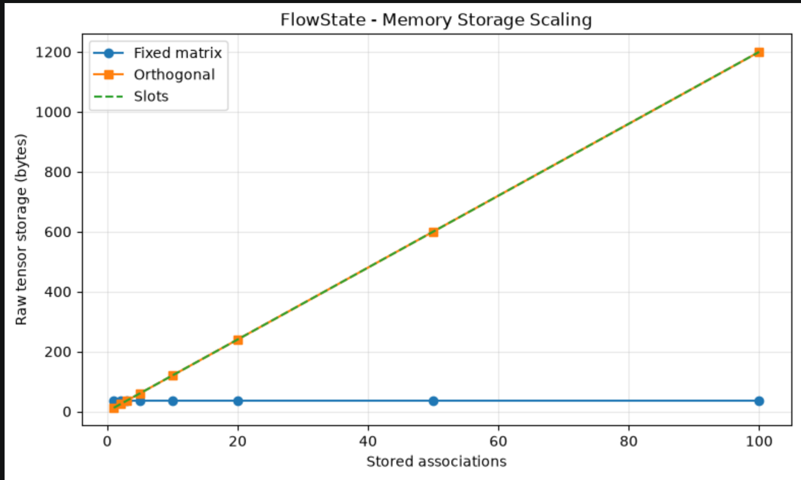

# FlowState Δ

**First-principles research training in recurrent dynamics, efficient sequence models, and reproducible neural-network experiments.**

FlowState Δ is an independent research and learning project. It starts with mathematical derivations and small PyTorch implementations, then progresses toward testing a focused hypothesis: **can input-varying liquid/state dynamics improve sequence modeling or efficiency under matched model, compute, and evaluation budgets?**

This is a work in progress, **not** a pretrained foundation model or a claim of architectural novelty. An educational result is recorded even when a simpler baseline performs better.

> **Current status (14 November 2026):** Chapters **1–6** have code or experiment artifacts; Chapter 6's introductory LTC-style lab and evidence package are published. Chapter 7 (CfC) is next. Faithful reproduction of published LTC/CfC experiments belongs to Chapter 8.

## Start here

| Track | Focus | Entry point |
| --- | --- | --- |
| **FlowState Δ** | From-scratch architectures, autodiff, dynamical systems, ODE solvers, liquid networks, then state-space / hybrid-model experiments | [Chapter index](#chapter-index) |
| **PrismLab** *(separate exploratory workbench)* | Quantized local inference, six LFM-family model pathways, modality routing and comparative measurements | [PrismLab README](lfm3-prismlab/README.md) |

PrismLab's exploratory observations may inform future FlowState experiments. Its local benchmarks are **not** evidence that a proposed FlowState architecture is more accurate or efficient, and PrismLab does not form part of the numbered curriculum.

## Chapter index

| Chapter | Focus | Evidence and code | Status |
| --- | --- | --- | --- |
| **[01](chap-1/README.md)** | Miniature Qwen3.5-inspired hybrid decoder: recurrent mixing, causal GQA, RMSNorm, SwiGLU | [Model](chap-1/mini_qwen.py) · [Tests](chap-1/test_hybrid.py) | Educational implementation |
| **[02](chap-2/README.md)** | Research engineering, learning-rate sensitivity, associative memory and confidence gating | [Memory benchmark](chap-2/final_memory_benchmark.ipynb) · [Figures](chap-2/figures/) | Exploratory experiments |
| **[03](chap-3/)** | Vector calculus, Jacobian/VJP/JVP/Hessian and finite-difference checks | [Gradient checks](chap-3/finite_diff.py) · [Hessian](chap-3/hessian.py) | Educational exercises |
| **[04](chap-4/README.md)** | Discrete/continuous state dynamics, eigenvalues, persistence and instability | [Dynamics lab](chap-4/dynamics_lab.ipynb) · [Plots](chap-4/plots/) | Educational experiments |
| **[05](chap-5/README.md)** | Euler, midpoint RK2, RK4; error, stability, function-evaluation cost | [Final lab](chap-5/07_final_lab.ipynb) · [Figures](chap-5/figures/) | Numerical experiments |
| **[06](chap-6/README.md)** | Scalar LTC-style neuron, BPTT training, EMA baseline and Euler/RK4 stability | [Executed lab](chap-6/FlowState_Ch06_LTC_Lab.ipynb) · [Figures and CSVs](chap-6/chapter6_outputs/) | **Introductory lab complete** |

**Important scope distinction:** these chapters establish understanding and reproducible examples. They do not yet constitute a new competitive language-model architecture or publication-grade model comparison.

## Evidence snapshot

### Chapter 2 — optimization and associative memory

In a small held-out text experiment (5 seeds, 50 updates), learning rate 0.001 produced a mean validation loss of **0.4083**, compared with **0.5915** for learning rate 0.01. Separate synthetic experiments explored key overlap, fixed-state capacity, orthogonal-key / explicit-slot storage and cosine-gated abstention. Results are specific to the tested setups; see the [full Chapter 2 report](chap-2/README.md).



### Chapter 5 — solver convergence on a controlled ODE

For the smooth scalar decay problem in Chapter 5, observed last-halving global orders were approximately **1.006** (Euler), **2.028** (RK2) and **4.030** (RK4). Accuracy, numerical stability and per-step cost are separate considerations; see the [full methods and caveats](chap-5/README.md).


### Chapter 6 — the simpler baseline wins

A **five-parameter scalar LTC-style cell** was trained on an 80-step synthetic pulse sequence generated by a fixed exponential moving average (EMA). It fitted the target and tracked new pulse timings, but a **one-parameter trainable EMA** represented the generating rule almost exactly.

| Model | Parameters | Train MSE | Test MSE |
| --- | ---: | ---: | ---: |
| Scalar LTC-style neuron | 5 | 0.00015758 | 0.00014072 |
| Trainable EMA | 1 | ~6.70e-12 | ~5.51e-12 |

Source: [Chapter 6 machine-readable results](chap-6/chapter6_outputs/summary_metrics.csv). The test pulses change timing, **not** the underlying target law. This is a baseline sanity check, not evidence of LTC superiority or real-world generalization.


The same chapter shows that **a stable continuous-time equation can become numerically unstable under explicit Euler integration** when the time step is too large. In the tested frozen-gate linear problem, Euler diverged at step size 2.5 while RK4 stayed bounded but inaccurate. [Read Chapter 6](chap-6/README.md).

## Research roadmap — curriculum v2.0 (October 2026)

The numbered roadmap follows the **72-chapter FlowState Research Curriculum v2.0**. It is a learning and experimentation sequence, not a claim that all phases have been implemented.

| Phase | Chapters | Subject |
| --- | --- | --- |
| 0 | 01–02 | Transformer competency and reproducible research setup |
| I | 03–08 | Autodiff, dynamical systems, numerical ODEs, LTC, CfC, reproduction |
| II | 09–15 | SSMs, S4/HiPPO, Mamba, input-varying state dynamics, liquid + LIV |
| III | 16–21 | Tokenization, local convolutions, state mixing, GQA and hybrid backbone |
| IV | 22–28 | Tiny LM training, matched baselines, efficiency, long-context evaluation, ablations |
| V | 29–36 | Vision, audio, multimodal fusion and evaluation |
| VI | 37–43 | Distillation, continual learning and internal/external memory |
| VII | 44–51 | Reinforcement learning, preference optimization and reasoning |
| VIII | 52–60 | Tool interfaces, agent loops, proactivity and action policies |
| IX | 61–66 | Quantization, native Rust inference, profiling and mobile edge deployment |
| X | 67–72 | Experimental methodology, literature, thesis writing, reproducible release |

The initial research claim should stay **narrow and falsifiable**. Multimodal, RL, agentic and edge systems are extensions, not prerequisites for every architecture experiment. Research logs, paper reading and reproducibility checks should begin early rather than waiting until Chapter 67.

## Reproduce the learning experiments

The repository contains independent chapter folders rather than a single ready-to-install LLM product. Use a Python environment with the dependencies described in each chapter README, and run the relevant notebook or script from its documented working directory.

For example, for the Chapter 6 lab:

```bash
cd chap-6
python ltc_neuron.py
python ltc_train.py
python ltc_stability.py
# Open FlowState_Ch06_LTC_Lab.ipynb in VS Code/Jupyter and Run All
```

The [Chapter 6 notebook](chap-6/FlowState_Ch06_LTC_Lab.ipynb) exports figures and CSV records to [`chapter6_outputs/`](chap-6/chapter6_outputs/). See each chapter's README for dataset, seed, solver and environment caveats.

## PrismLab — related, but separate

[PrismLab](lfm3-prismlab/README.md) is an exploratory local multimodal-inference workbench, with six registered and locally validated model pathways: LFM3-1.7B, LFM3-VL-2B, LFM3-Audio-2B, LFM3-Omni-2B, d1-2B and d1-Omni-2B. Its report documents quantized CPU inference, routing, vision/audio and decision-model tests. Any hosted playground depends on a separately operated local backend; the repository does **not** imply a permanently available inference service.

Liquid AI's **LFM3** model family and the classical **LTC** equation studied in Chapter 6 are not interchangeable architectures. We will inspect published LFM model components separately when relevant to later backbone, multimodal and edge studies.

## Research integrity

- Record assumptions, exact code, seeds, metrics, artifacts and negative results. Distinguish measurement from interpretation.
- Compare against the **simplest strong baseline** before claiming a gain; match budgets as closely as feasible.
- Do not generalize synthetic one-seed experiments to full-scale foundation models or edge-device efficiency.
- No commercial affiliation with Liquid AI, Qwen/Alibaba, or authors of the referenced architectures is implied.

**Reading:** [Hasani et al., *Liquid Time-constant Networks*](https://arxiv.org/abs/2006.04439) · [Hasani et al., *Closed-form Continuous-time Neural Networks*](https://www.nature.com/articles/s42256-022-00556-7) · [S4](https://arxiv.org/abs/2111.00396) · [Mamba](https://arxiv.org/abs/2312.00752).

---

**Maintainer:** [Pratay Karali](https://github.com/prataykarali) · **Repository status:** active foundational study and experiment tracking.
