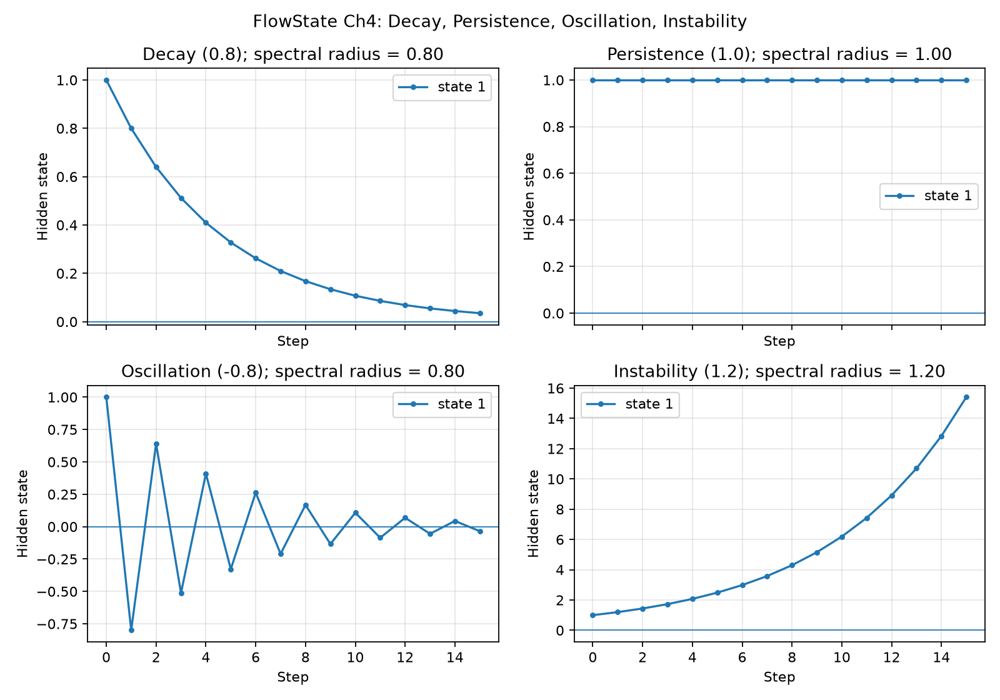
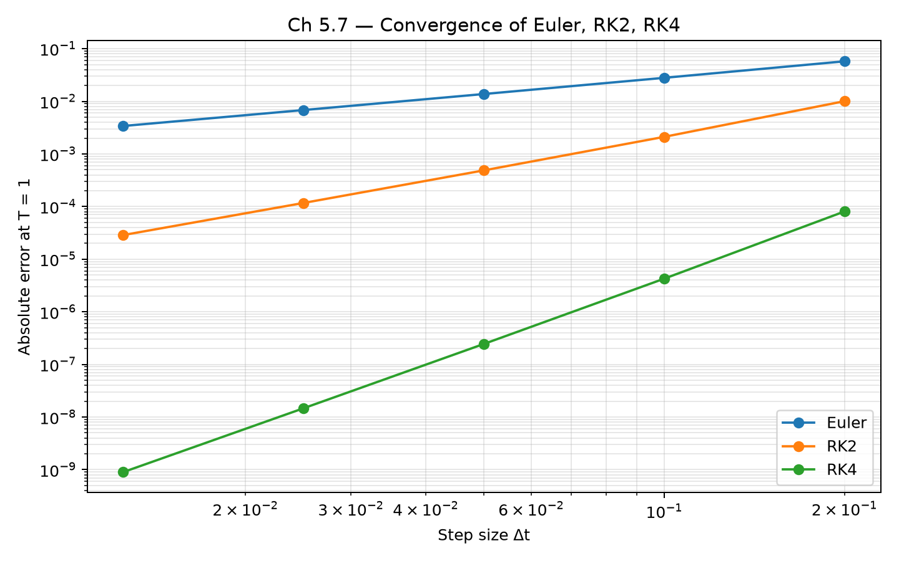
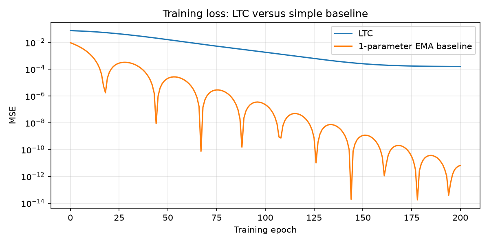
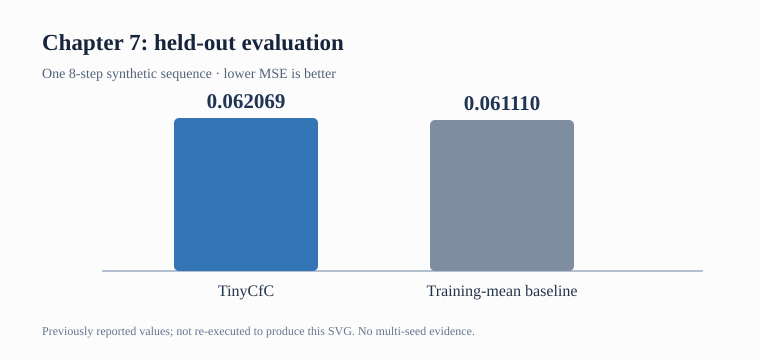

# FlowState Δ

**First-principles research training in recurrent dynamics, efficient sequence models, and reproducible neural-network experiments.**

FlowState Δ is an independent research and learning project. It starts with mathematical derivations and small PyTorch implementations, then progresses toward testing a focused hypothesis: **can input-varying liquid/state dynamics improve sequence modeling or efficiency under matched model, compute, and evaluation budgets?**

This is a work in progress, **not** a pretrained foundation model or a claim of architectural novelty. An educational result is recorded even when a simpler baseline performs better.

> **Current status (17 November 2026):** Chapters **1–7** have introductory educational code or experiment artifacts. Chapter 7 CfC-style lab, notebook, reported figures and provenance-labeled comparison have been documented. Faithful LTC/CfC reproduction, controlled multi-seed comparisons and accuracy/compute budgeting belong to Chapter 8.

**Research progress ledger:** [Parallel milestones (C/P/E/B/M/N/W/R/T)](RESEARCH_MILESTONES.md) — current evidence status, paper-reading gates, Nishant N1 trigger and memory-research timing. This is the source of truth for *planned vs actually completed* activities.

## Start here

| Track | Focus | Entry point |
| --- | --- | --- |
| **FlowState Δ** | From-scratch architectures, autodiff, dynamical systems, ODE solvers, liquid networks, then state-space / hybrid-model experiments | [Chapter index](#chapter-index) |
| **PrismLab** *(separate exploratory workbench)* | Quantized local inference, six LFM-family model pathways, modality routing and comparative measurements | [PrismLab README](lfm3-prismlab/README.md) |

PrismLab's exploratory observations may inform future FlowState experiments. Its local benchmarks are **not** evidence that a proposed FlowState architecture is more accurate or efficient, and PrismLab does not form part of the numbered curriculum.

## Chapter index

| Chapter | Focus | Evidence and code | Status |
| --- | --- | --- | --- |
| **[01](chap-1/README.md)** | Miniature Qwen3.5-inspired hybrid decoder: recurrent mixing, causal GQA, RMSNorm, SwiGLU | [Model](chap-1/mini_qwen.py) · [Tests](chap-1/test_hybrid.py) | Educational implementation |
| **[02](chap-2/README.md)** | Research engineering, learning-rate sensitivity, associative memory and confidence gating | [Memory benchmark](chap-2/final_memory_benchmark.ipynb) · [Figures](chap-2/figures/) | Exploratory experiments |
| **[03](chap-3/)** | Vector calculus, Jacobian/VJP/JVP/Hessian and finite-difference checks | [Gradient checks](chap-3/finite_diff.py) · [Hessian](chap-3/hessian.py) | Educational exercises |
| **[04](chap-4/README.md)** | Discrete/continuous state dynamics, eigenvalues, persistence and instability | [Dynamics lab](chap-4/dynamics_lab.ipynb) · [Plots](chap-4/plots/) | Educational experiments |
| **[05](chap-5/README.md)** | Euler, midpoint RK2, RK4; error, stability, function-evaluation cost | [Final lab](chap-5/07_final_lab.ipynb) · [Figures](chap-5/figures/) | Numerical experiments |
| **[06](chap-6/README.md)** | Scalar LTC-style neuron, BPTT training, EMA baseline and Euler/RK4 stability | [Executed lab](chap-6/FlowState_Ch06_LTC_Lab.ipynb) · [Figures and CSVs](chap-6/chapter6_outputs/) | **Introductory lab complete** |
| **[07](chap-7/README.md)** | CfC-style gated state update, analytic targets, held-out loss and reported Ch1-adapted comparison | [New notebook](chap-7/FlowState_Ch07_CfC_Lab.ipynb) · [Comparison script](chap-7/compare_ch1_ch7.py) · [Figures](chap-7/figures/) | **Introductory lab complete; comparisons exploratory** |

**Important scope distinction:** these chapters establish understanding and reproducible examples. They do not yet constitute a new competitive language-model architecture or publication-grade model comparison.

## Chapter highlights — 1 through 7

The examples below are educational, limited-scope measurements. Each chapter's linked files contain the implementation and its specific assumptions.

### Chapter 1 — from-scratch hybrid language model

Implemented a tiny **Qwen3.5-inspired**, but **not architecture-identical**, decoder in PyTorch: byte embeddings (vocabulary 256), **3 GatedDeltaNet-style token-mixing layers + 1 causal grouped-query attention layer**, RMSNorm, SwiGLU and an autoregressive output head. Configuration: hidden dimension 128, four query heads and two shared key/value heads. Shape, gradient and causal-prefix smoke tests were reported.

On **one training sentence** (“A dragon guards a tiny library.”), next-token cross-entropy dropped from **5.6243** at step 0 to **0.0023** at step 200; greedy decoding reproduced the memorized continuation. A novel prompt (“A rabbit”) generated incoherent text. **This is evidence of memorization, not language-model generalization.**

[Chapter 1 methods and limitations](chap-1/README.md) · [Model implementation](chap-1/mini_qwen.py) · [Training script](chap-1/train_hybrid.py) · [Architecture tests](chap-1/test_hybrid.py)

### Chapter 2 — optimization and associative memory

In a small held-out text experiment (5 seeds, 50 updates), learning rate 0.001 produced a mean validation loss of **0.4083**, compared with **0.5915** for learning rate 0.01. Separate synthetic experiments explored key overlap, fixed-state capacity, orthogonal-key / explicit-slot storage and cosine-gated abstention. Results are specific to the tested setups; see the [full Chapter 2 report](chap-2/README.md).


### Chapter 3 — autodiff, Jacobians, JVP/VJP and Hessians

Verified small derivatives against PyTorch autodiff, analytic expectations and finite differences. For `f(x₁,x₂) = x₁² + 3x₁x₂ + 2x₂²` at `x = [1, 2]`, the code checks **gradient [8, 11]** and **Hessian [[2, 3], [3, 4]]**. Central finite differences at `h=1e-3` pass a strict gradient check. Separate examples compare a vector-Jacobian product with explicit matrix multiplication and calculate a Jacobian-vector product.

These are foundational **small-scale correctness exercises**, not evidence of new autodiff algorithms or performance gains. Chapter 3 currently has scripts but no dedicated README/notebook.

[Finite-difference verification](chap-3/finite_diff.py) · [Hessian and eigenvector checks](chap-3/hessian.py) · [VJP verification](chap-3/vector_vjp.py) · [JVP demo](chap-3/jvp.py)

### Chapter 4 — dynamical systems and state stability

Explored `h[t+1] = A h[t] + B x[t]`, connecting state-transition eigenvalues with decay, persistence, alternating signs and instability. In one coupled two-dimensional example, the stable matrix had spectral radius **≈0.8562**; changing a single diagonal coefficient gave a system with spectral radius **≈1.2275** and growing trajectories. An input-pulse experiment also showed that internal state continues evolving after external input becomes zero.



[Chapter 4 derivations and experiments](chap-4/README.md) · [Executed dynamics lab](chap-4/dynamics_lab.ipynb) · [Coupled-system figure](chap-4/plots/coupled_dynamics.png)

### Chapter 5 — solver convergence on a controlled ODE

For the smooth scalar decay problem in Chapter 5, observed last-halving global orders were approximately **1.006** (Euler), **2.028** (RK2) and **4.030** (RK4). Accuracy, numerical stability and per-step cost are separate considerations; see the [full methods and caveats](chap-5/README.md).



### Chapter 6 — the simpler baseline wins

A **five-parameter scalar LTC-style cell** was trained on an 80-step synthetic pulse sequence generated by a fixed exponential moving average (EMA). It fitted the target and tracked new pulse timings, but a **one-parameter trainable EMA** represented the generating rule almost exactly.

| Model | Parameters | Train MSE | Test MSE |
| --- | ---: | ---: | ---: |
| Scalar LTC-style neuron | 5 | 0.00015758 | 0.00014072 |
| Trainable EMA | 1 | ~6.70e-12 | ~5.51e-12 |

Source: [Chapter 6 machine-readable results](chap-6/chapter6_outputs/summary_metrics.csv). The test pulses change timing, **not** the underlying target law. This is a baseline sanity check, not evidence of LTC superiority or real-world generalization.



The same chapter shows that **a stable continuous-time equation can become numerically unstable under explicit Euler integration** when the time step is too large. In the tested frozen-gate linear problem, Euler diverged at step size 2.5 while RK4 stayed bounded but inaccurate. [Read Chapter 6](chap-6/README.md).

### Chapter 7 — CfC-style gating and an honest held-out test

A 305-parameter TinyCfC-inspired sequence model implemented a learned time-gated recurrence and was trained on a six-point analytical synthetic sequence. Student-reported training MSE was **0.000173**, but its eight-step held-out MSE (**0.062069**) was slightly worse than the constant training-mean baseline (**0.061110**). This is a small, preliminary negative generalization result, not a faithful published CfC reproduction.



An earlier **local, uncommitted** Chapter 1-adapted vs Chapter 7 synthetic experiment was reported in chat; its numbers are preserved as a provenance-labelled summary, while a **new**, separately identified comparison script offers fresh, runnable experiments. The adapted models are not parameter/compute matched: do **not** interpret this as architecture superiority.

[Chapter 7 methods, evidence and limitations](chap-7/README.md) · [Notebook](chap-7/FlowState_Ch07_CfC_Lab.ipynb) · [Reconstructed reported comparison](chap-7/results/ch1_ch7_reported_summary.csv)

## Primary syllabus — v2.1 (20 November 2026)

**[Full canonical list of all 72 chapters with optional LittleBit-2 extensions](FLOWSTATE_PRIMARY_CURRICULUM_72_V2_1.md)** · [Detailed compression experiments and Android gates](LITTLEBIT2_QUANTIZATION_ENRICHMENT.md).

The original October 2026 v2.0 72-chapter order and titles are unchanged. Compression is an *optional internal enrichment*, not a new chapter or a demonstrated edge speedup. The primary FlowState hypothesis and scientific milestones remain fixed.

## Research roadmap — curriculum v2.0 (October 2026)

The numbered roadmap follows the **72-chapter FlowState Research Curriculum v2.0**. It is a learning and experimentation sequence, not a claim that all phases have been implemented.

| Phase | Chapters | Subject |
| --- | --- | --- |
| 0 | 01–02 | Transformer competency and reproducible research setup |
| I | 03–08 | Autodiff, dynamical systems, numerical ODEs, LTC, CfC, reproduction |
| II | 09–15 | SSMs, S4/HiPPO, Mamba, input-varying state dynamics, liquid + LIV |
| III | 16–21 | Tokenization, local convolutions, state mixing, GQA and hybrid backbone |
| IV | 22–28 | Tiny LM training, matched baselines, efficiency, long-context evaluation, ablations |
| V | 29–36 | Vision, audio, multimodal fusion and evaluation |
| VI | 37–43 | Distillation, continual learning and internal/external memory |
| VII | 44–51 | Reinforcement learning, preference optimization and reasoning |
| VIII | 52–60 | Tool interfaces, agent loops, proactivity and action policies |
| IX | 61–66 | Quantization, native Rust inference, profiling and mobile edge deployment |
| X | 67–72 | Experimental methodology, literature, thesis writing, reproducible release |

The initial research claim should stay **narrow and falsifiable**. Multimodal, RL, agentic and edge systems are extensions, not prerequisites for every architecture experiment. Research logs, paper reading and reproducibility checks should begin early rather than waiting until Chapter 67.

**Optional compression enrichment (planned, not performed):** [LittleBit / LittleBit-2 — low-rank binary factorization, QAT and future Android evaluation](LITTLEBIT2_QUANTIZATION_ENRICHMENT.md) augments Chapters 13, 24, 37–39 and 61–66 *without* changing the canonical chapter sequence. This is not a current implementation milestone or a claim of on-device performance.

## Reproduce the learning experiments

The repository contains independent chapter folders rather than a single ready-to-install LLM product. Use a Python environment with the dependencies described in each chapter README, and run the relevant notebook or script from its documented working directory.

For example, for the Chapter 6 lab:

```bash
cd chap-6
python ltc_neuron.py
python ltc_train.py
python ltc_stability.py
# Open FlowState_Ch06_LTC_Lab.ipynb in VS Code/Jupyter and Run All
```

The [Chapter 6 notebook](chap-6/FlowState_Ch06_LTC_Lab.ipynb) exports figures and CSV records to [`chapter6_outputs/`](chap-6/chapter6_outputs/). See each chapter's README for dataset, seed, solver and environment caveats.

For Chapter 7: `cd chap-7 && python cfc_cell.py && python temporal_target.py && python train_cfc.py`; then Run All in [the Chapter 7 notebook](chap-7/FlowState_Ch07_CfC_Lab.ipynb). For the independent synthetic Ch1-adapted comparison run `python chap-7/compare_ch1_ch7.py` **from the repository root**. Fresh outputs are produced only when those programs are executed.

## PrismLab — related, but separate

[PrismLab](lfm3-prismlab/README.md) is an exploratory local multimodal-inference workbench, with six registered and locally validated model pathways: LFM3-1.7B, LFM3-VL-2B, LFM3-Audio-2B, LFM3-Omni-2B, d1-2B and d1-Omni-2B. Its report documents quantized CPU inference, routing, vision/audio and decision-model tests. Any hosted playground depends on a separately operated local backend; the repository does **not** imply a permanently available inference service.

Liquid AI's **LFM3** model family and the classical **LTC** equation studied in Chapter 6 are not interchangeable architectures. We will inspect published LFM model components separately when relevant to later backbone, multimodal and edge studies.

## Research integrity

- Record assumptions, exact code, seeds, metrics, artifacts and negative results. Distinguish measurement from interpretation.
- Compare against the **simplest strong baseline** before claiming a gain; match budgets as closely as feasible.
- Do not generalize synthetic one-seed experiments to full-scale foundation models or edge-device efficiency.
- No commercial affiliation with Liquid AI, Qwen/Alibaba, or authors of the referenced architectures is implied.

**Reading:** [Hasani et al., *Liquid Time-constant Networks*](https://arxiv.org/abs/2006.04439) · [Hasani et al., *Closed-form Continuous-time Neural Networks*](https://www.nature.com/articles/s42256-022-00556-7) · [S4](https://arxiv.org/abs/2111.00396) · [Mamba](https://arxiv.org/abs/2312.00752).

---

**Maintainer:** [Pratay Karali](https://github.com/prataykarali) · **Repository status:** active foundational study and experiment tracking.
