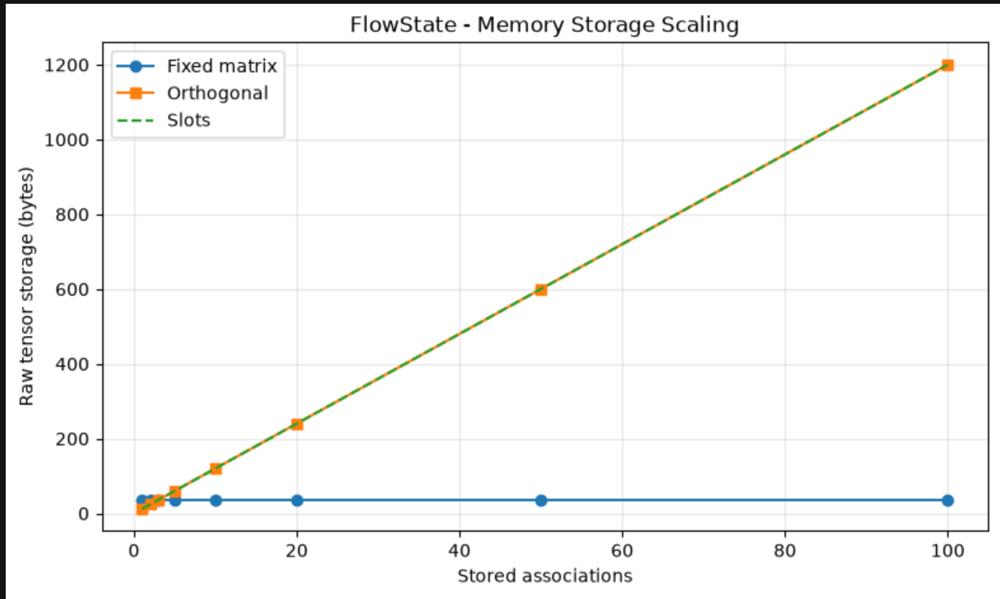
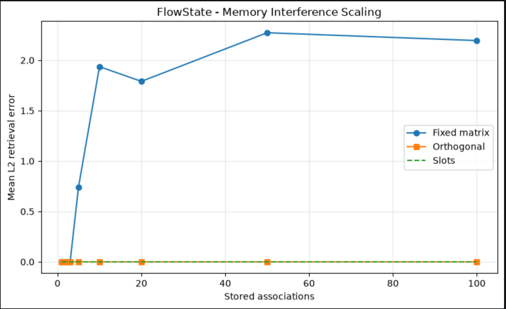
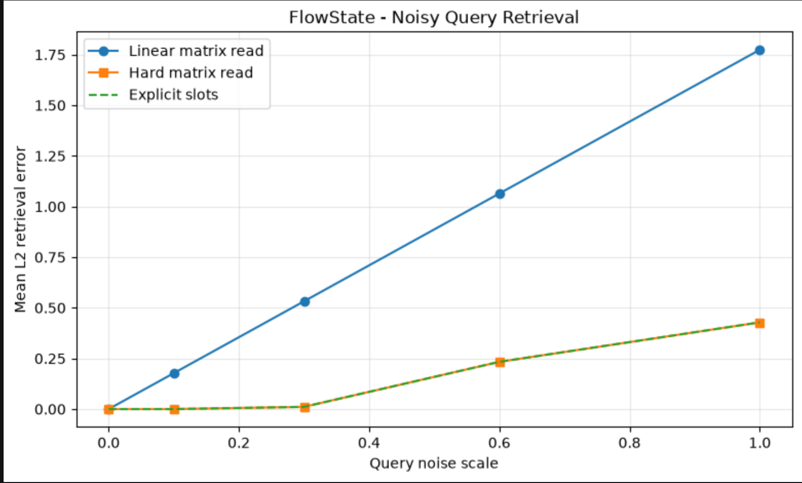
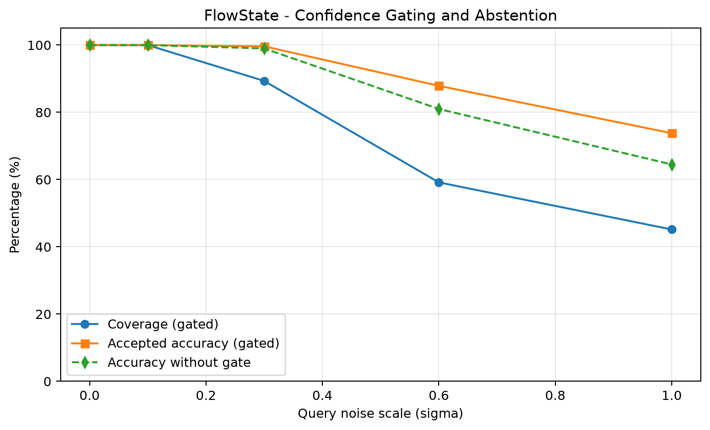

# FlowState — Chapter 2

## Experimental Foundations and Associative Memory

**Project:** FlowState Δ
**Chapter:** 02 — Research Engineering and Associative Memory
**Framework:** PyTorch
**Experiment dates:** October 2026
**Status:** Experiments completed; repository verification pending

---

## 1. Abstract

This chapter investigates the reproducibility, optimization behavior, storage capacity, and retrieval limitations of small neural and associative-memory architectures through controlled PyTorch experiments.

We first evaluated learning-rate sensitivity using our miniature Qwen3.5-inspired hybrid language model, incorporating GatedDeltaNet-style recurrent mixing and grouped-query full attention. Across five random seeds and 50 training updates, a learning rate of 0.001 achieved lower mean validation loss (0.4083) than 0.01 (0.5915) on a small held-out dataset.

Next, we investigated fixed-dimensional delta-rule associative memory, orthogonal-key representations, and explicit multi-slot storage. We evaluated retrieval fidelity, interference between key–value associations, sensitivity to write order, raw numerical storage requirements, and scaling behavior as the number of associations increased.

Our experiments demonstrated that overlapping key directions can introduce interference into previously stored associations, while sufficiently many orthogonal key directions or independently indexed slots can preserve the tested values accurately. However, these approaches introduce trade-offs involving key dimensionality, storage growth, and retrieval mechanisms.

We also demonstrated variable-dimensional value recovery through dynamic storage and padding with length metadata.

Finally, we examined retrieval under synthetic Gaussian query noise and introduced cosine-similarity-based confidence gating with abstention. Our measurements revealed a trade-off between retrieval coverage and accuracy among accepted queries.

These experiments provide component-level insights related to the memory mechanisms studied in our miniature hybrid decoder. They do not constitute benchmarks of Qwen3.5 itself or establish architectural superiority.

---

## 2. Research Objectives

This chapter was designed to answer six questions:

1. How do random initialization and learning rate affect training reproducibility and validation performance?
2. Can a fixed-size recurrent matrix store and retrieve key–value associations accurately?
3. What happens when different associations use overlapping keys or when the same key is updated repeatedly?
4. Can orthogonal keys or independently indexed slots prevent retrieval interference?
5. How can one logical entity store multiple values with different dimensions?
6. Can confidence-based abstention improve retrieval reliability under noisy queries?

The goal was to establish measurable baselines before investigating more sophisticated memory architectures.

---

## 3. Experimental Environment

### Model

The training experiments reuse the miniature hybrid decoder developed in Chapter 1.

Its configuration includes:

- Byte-level vocabulary of 256 tokens.
- Hidden dimension of 128.
- Four decoder blocks: three GatedDeltaNet-style blocks and one grouped-query attention block.
- Four query heads and two key/value heads.
- RMSNorm, SwiGLU, residual connections, and causal next-token prediction.

This is an educational PyTorch implementation inspired by hybrid language-model architectures, not an exact reproduction of a pretrained Qwen3.5 model.

### Tools

- Python 3.12
- PyTorch
- NumPy
- Matplotlib
- Jupyter notebooks
- JSON for structured experiment logging

The precise dependency versions and Git commit should be recorded for reproducibility.

---

## 4. Experiment 1 — Learning-Rate Sensitivity

### Methodology

We trained the miniature hybrid model using AdamW with two learning rates:

- LR = 0.001
- LR = 0.01

The initial experiment repeatedly optimized the sentence:

`A dragon guards a tiny library.`

We first examined short optimization horizons and then extended training to 50 updates.

To investigate generalization, we introduced four training sentences and two held-out sentences.

**Training examples:**

- A dragon guards a tiny library.
- A dragon reads a dusty book.
- A wizard guards an old library.
- A knight reads a tiny book.

**Validation examples:**

- A wizard reads a dusty book.
- A knight guards an old library.

Five random seeds were used:

`[7, 21, 42, 99, 123]`

The same seeds were used for both learning rates to create paired comparisons.

### Results

| Metric                             | LR = 0.001 | LR = 0.01 |
| ---------------------------------- | ---------: | --------: |
| Training updates                   |         50 |        50 |
| Random seeds                       |          5 |         5 |
| Mean validation loss               | **0.4083** |    0.5915 |
| Validation-loss standard deviation | **0.0421** |    0.0550 |
| Seeds with lower validation loss   |    **5/5** |       0/5 |

The mean paired validation-loss difference was approximately 0.1832 in favor of LR = 0.001.

### Observations

The larger learning rate optimized the original single-sentence task faster.

However, under the later multi-sentence setup, LR = 0.001 achieved lower validation loss across all five tested seeds after 50 updates.

These observations show that faster initial optimization does not necessarily imply better validation performance.

### Limitations

The dataset was extremely small, consisting of short sentences with substantial vocabulary overlap.

The results establish behavior only for the tested model, dataset, optimizer, seeds, and training horizon. They do not establish an optimal learning rate for larger language models.

---

## 5. Experiment A — Fixed-Dimensional Delta-Rule Memory

### Objective

Investigate how a fixed-size recurrent matrix stores and retrieves associations between numerical keys and values.

### Architecture

Let:

- (k_t) be a key vector.
- (v_t) be a target value vector.
- (S_t) be the recurrent memory state.
- (\beta) be the update strength.

The simplified delta-rule update is:

[
S\_{t+1}=S_t+\beta k_t(v_t-k_t^\top S_t)^\top
]

Retrieval uses:

[
\hat v = k^\top S
]

In PyTorch, the corresponding operations are:

```python
prediction = k @ S
error = v - prediction
S = S + beta * torch.outer(k, error)
retrieved = k @ S
```

### Findings

**A1 — Single association**

A unit-length key with beta = 1 successfully stored and retrieved a three-dimensional value from an initially empty memory.

**A2 — Repeated updates**

With beta = 0.5, each update corrected half the remaining prediction error for the tested unit-length key.

**A3 — Same-key overwrite**

Writing a different value under the same unit-length key with beta = 1 replaced the previously retrieved value.

This showed that the simple matrix read does not independently return multiple arbitrary values under an unchanged key and unchanged state.

---

## 6. Experiment B — Multiple Values and Retrieval Interference

### Objective

Compare a fixed-size associative matrix with explicit value slots and orthogonal-key representations.

### B1 — Explicit Attribute Storage

We implemented one logical entity with multiple independently retrievable attributes:

```python
memory = {
    "dragon": {
        "color": "red",
        "age": 500,
        "element": "fire"
    }
}
```

Updating the age attribute to 600 preserved the color and element entries.

This demonstrated attribute-level replacement without overwriting unrelated entries.

### B2 — Independent Vector Slots

The same storage mechanism was extended to numerical vectors:

```python
v_color = [1.0, 0.0, 0.0]
v_age = [0.5, 0.2, 0.8]
v_element = [0.0, 1.0, 1.0]
```

All three were retrieved successfully using explicit entity–attribute indexing.

This method provides separate storage locations, but is not itself a recurrent neural memory mechanism.

### B3 — Overlapping Keys

We tested three associations using a two-dimensional key space:

[
k_1=[1,0]
]

[
k_2=[0,1]
]

[
k_3=[1/\sqrt{2},1/\sqrt{2}]
]

The third key overlaps both earlier directions.

After sequential writes, the retrieval errors were approximately:

| Association | L2 error |
| ----------- | -------: |
| Color       |   1.0126 |
| Age         |   1.0126 |
| Element     |   0.0000 |

The latest association was retrieved accurately, while earlier associations experienced interference.

Reversing the write order preserved Color and Age but increased Element's error to approximately 1.4321.

This demonstrated that retrieval interference depends on both key geometry and update order.

### B4 — Orthogonal Key Separation

We increased the key dimension to three and assigned independent one-hot keys.

All three target vectors were recovered with zero reported retrieval error.

### Storage Comparison

| Representation              | Raw numerical storage | Retrieval behavior      |
| --------------------------- | --------------------: | ----------------------- |
| 2D recurrent matrix         |              24 bytes | Interference observed   |
| 3D orthogonal matrix        |              36 bytes | Exact retrieval in test |
| Three explicit vector slots |              36 bytes | Exact retrieval in test |

These measurements count numerical payloads only.

They exclude key storage, dictionary overhead, indexing structures, tensor allocation overhead, and other runtime costs.

### Memory Storage Scaling



**Figure 2:** Raw numerical storage increases linearly for
expanding orthogonal memory and explicit slots, while the
fixed-dimensional matrix maintains constant state size.
Key/index overhead is excluded.


### Interpretation

Orthogonal directions reduced interference in the controlled experiment.

However, supporting N mutually orthogonal nonzero keys requires a key space with at least N dimensions.

The experiment does not show that orthogonal keys provide unlimited associative-memory capacity.

---

## 7. Experiment C — Variable-Dimensional Value Storage

### Objective

Investigate whether one logical entity can retain multiple versions of its value vector when their dimensions differ.

### C1 — Dynamic Storage

Three versions were stored under the logical entity `dragon`:

| Version | Dimensions |
| ------- | ---------: |
| V1      |          3 |
| V2      |          5 |
| V3      |          8 |

A Python dictionary containing lists of cloned PyTorch tensors preserved all three versions.

This enabled independent retrieval without forcing every version to have the same dimension.

### C2 — Padded Storage

An alternative representation padded every vector to dimension 8.

We stored original lengths separately:

`[3, 5, 8]`

During retrieval, each vector was sliced according to its original length.

All three values were reconstructed with their original shapes.

### Storage Results

| Representation           | Raw payload |
| ------------------------ | ----------: |
| Dynamic vectors          |    64 bytes |
| Padded matrix            |    96 bytes |
| Length metadata (int64)  |    24 bytes |
| Padded matrix + metadata |   120 bytes |

Dynamic storage required fewer numerical payload bytes for these particular vectors.

However, this does not guarantee lower total runtime memory, because independently allocated tensors and Python containers also introduce overhead.

### Architectural Limitation

A fixed-width linear matrix read produces a fixed-dimensional output.

Variable-length external storage or a separate encoding-and-decoding mechanism is required to recover arbitrary differently sized values.

Our experiment demonstrated external storage and reconstruction, not an intrinsic variable-width GatedDeltaNet state.

---

## 8. Memory Capacity and Scaling

We extended the fixed-value experiments from 1 to 100 associations.

Three approaches were compared:

- Fixed 3 × 3 matrix.
- Expanding orthogonal matrix.
- Explicit vector slots.

### Observations

The fixed matrix maintained constant state size, while retrieval interference appeared as additional overlapping associations were written.

The expanding orthogonal representation and explicit slots preserved the synthetic target vectors exactly under ideal indexing.

### Memory Interference Scaling



**Figure 1:** Mean L2 retrieval error as stored associations increase
from 1 to 100. The fixed-size matrix experiences interference,
while the idealized expanding orthogonal and explicit-slot
baselines preserve the tested values.

### Raw Numerical Storage at 100 Associations

| Architecture                | Bytes |
| --------------------------- | ----: |
| Fixed matrix                |    36 |
| Expanding orthogonal matrix | 1,200 |
| Explicit vector slots       | 1,200 |

The fixed matrix demonstrated constant state storage for fixed dimensions.

The other two representations demonstrated linearly growing value/state payload storage in this experimental setup.

The orthogonal experiment used identity-matrix keys. The cost of materializing or storing those keys was not included in the reported state-memory measurements.

### Conclusion

Fixed-state compression and independent exact retrieval impose different capacity requirements.

Our results demonstrate a trade-off within the tested representations, not a universal limit or performance ranking for all recurrent neural architectures.

---

## 9. Noisy-Query Retrieval

### Objective

Measure how retrieval behavior changes when queries deviate from their intended key directions.

Synthetic queries were generated using:

[
q\_{\text{noisy}}=q\_{\text{original}}+\sigma\epsilon
]

where epsilon contains Gaussian noise and sigma controls its standard deviation.

Three retrieval methods were evaluated:

1. Direct linear matrix retrieval.
2. Hard row selection.
3. Explicit indexed slot selection.

Each noise level was evaluated using 600 synthetic queries.

### Results

| Noise σ | Linear mean L2 | Hard/slot mean L2 | Selection accuracy |
| ------- | -------------: | ----------------: | -----------------: |
| 0.0     |         0.0000 |            0.0000 |             100.0% |
| 0.1     |         0.1774 |            0.0000 |             100.0% |
| 0.3     |         0.5321 |            0.0109 |              99.0% |
| 0.6     |         1.0642 |            0.2331 |              81.0% |
| 1.0     |         1.7737 |            0.4281 |              64.5% |

### Noise Sensitivity



**Figure 3:** Direct linear retrieval experiences increasing
L2 error under synthetic Gaussian query noise. Hard matrix
retrieval and indexed slots produce identical results in
this controlled one-hot-key experiment.

### Interpretation

Direct linear retrieval combined stored value vectors according to the noisy query coefficients.

Hard selection avoided such mixing when the correct slot was selected.

However, hard selection could return an entirely incorrect stored vector when noise caused another slot to win.

Hard matrix and explicit-slot results were identical because both used the same selected indices and stored numerical values.

This experiment did not evaluate realistic learned embedding retrieval.

---

## 10. Confidence-Gated Retrieval and Abstention

### Objective

Investigate whether a retrieval system can improve reliability by refusing low-similarity matches instead of always returning a value.

### Methodology

We implemented a cosine-similarity matching function.

For every query:

1. Normalize the query and stored keys.
2. Compute cosine similarity scores.
3. Identify the best-matching key.
4. Accept the retrieval if the maximum similarity exceeds the chosen threshold.
5. Otherwise abstain.

The illustrative threshold was 0.80.

Two measurements were recorded:

**Coverage:** Percentage of all queries accepted.

**Accepted accuracy:** Percentage of accepted queries that selected the correct slot.

### Results

| Noise σ | Coverage | Accepted accuracy |
| ------- | -------: | ----------------: |
| 0.0     |  100.00% |           100.00% |
| 0.1     |  100.00% |           100.00% |
| 0.3     |   89.33% |            99.63% |
| 0.6     |   59.17% |            87.89% |
| 1.0     |   45.17% |            73.80% |

### Confidence–Coverage Trade-off



**Figure 4:** Impact of cosine-similarity thresholding
on retrieval coverage and accepted-query accuracy.

With a threshold of 0.80, the system abstains more frequently
as query noise increases. Accepted-query accuracy exceeds
the ungated accuracy in the tested noisy conditions, but
coverage decreases substantially.

The threshold was illustrative and was not independently
calibrated.

### Findings

The gate rejected more queries as noise increased.

Compared with always selecting a slot, the thresholded system achieved higher accuracy among accepted queries at the higher tested noise levels, but answered fewer queries.

At noise 1.0, it answered approximately 45.17% of queries with 73.80% accepted accuracy.

### Limitations

Cosine similarity is not a calibrated probability of correctness.

The threshold was not tuned using an independent calibration dataset.

The experiment also assumed that every query originated from one of the three known slots.

Truly unrelated queries, unknown entities, and out-of-distribution embeddings remain untested.

Therefore, these results do not establish a reliable factual-abstention system.

---

## 11. Consolidated Research Findings

| Research question                                                    | Experimental observation                                                    |
| -------------------------------------------------------------------- | --------------------------------------------------------------------------- |
| Does learning rate influence optimization?                           | Yes, different rates produced different convergence and validation behavior |
| Can a fixed matrix store an association?                             | Yes, under the tested conditions                                            |
| Can identical keys retrieve multiple arbitrary values independently? | Not through the tested unchanged linear read                                |
| Do overlapping keys interfere?                                       | Yes, in the tested delta-rule memory                                        |
| Can orthogonal keys prevent interference?                            | Yes, for the tested independent key directions                              |
| Can explicit slots preserve multiple values?                         | Yes, with independent indexing                                              |
| Can variable-sized values be recovered?                              | Yes, using dynamic storage or padding plus length metadata                  |
| Does fixed-state storage have capacity limitations?                  | Yes, for arbitrary independent associations under this linear mapping       |
| Does discrete selection avoid linear blending?                       | Yes, when the intended slot is selected                                     |
| Can abstention improve accepted-query accuracy?                      | Yes, in parts of our controlled noise experiment, at reduced coverage       |

These findings motivate further investigation of hybrid memory designs combining compact recurrent state with indexed external storage.

They do not establish that any tested method is universally superior.

---

## 12. Reproducibility

### Project Files

```text
chap-2/
├── reproducibility.py
├── experiment_a.py
├── learning_rate.ipynb
├── associative_memory_A.ipynb
├── associative_memory_B.ipynb
├── associative_memory_C.ipynb
├── final_memory_benchmark.ipynb
├── results/
│   ├── lr_validation_50steps.json
│   └── chapter2_memory_benchmark.json
└── README.md
```

### Running the Experiments

From the FlowState repository root, activate the existing Python environment and launch Jupyter:

```bash
source .venv/bin/activate
jupyter lab
```

If JupyterLab is not installed, install it in the project environment or use the VS Code Jupyter extension.

Run the notebooks in this order:

1. `learning_rate.ipynb`
2. `associative_memory_A.ipynb`
3. `associative_memory_B.ipynb`
4. `associative_memory_C.ipynb`
5. `final_memory_benchmark.ipynb`

Use **Restart Kernel and Run All** to verify that each notebook runs correctly without relying on hidden state from previous interactive sessions.

### Reproducibility Notes

- The learning-rate study used paired random seeds.
- Synthetic retrieval experiments used seeded random inputs.
- The reported storage figures use raw tensor element counts and data-type sizes.
- Notebook outputs were supported by numerical assertions and JSON verification.
- Exact reproduction can also depend on PyTorch version, hardware backend, numerical precision, and deterministic execution settings.

For an archival reproduction, record the source-code commit, Python version, PyTorch version, dependency list, and hardware configuration.

---

## 13. Limitations

The most important limitations of this work are:

- The neural-network training dataset is too small for broad generalization claims.
- Associative-memory experiments use manually constructed keys and numerical values.
- Perfectly orthogonal one-hot keys are idealized representations.
- Several comparisons exclude indexing, key storage, allocation, and metadata overhead.
- Most component experiments use deterministic toy setups rather than representative language-model workloads.
- No full Qwen3.5 checkpoint was trained or evaluated in these memory benchmarks.
- Synthetic Gaussian perturbations are not equivalent to real embedding errors.
- Confidence thresholds were not independently calibrated.
- The experiments do not demonstrate a novel or superior memory architecture.

These results should be interpreted as controlled component-level demonstrations.

---

## 14. Future Research Directions

### Memory representation

Investigate learned key projections, key interference, orthogonality constraints, selective updates, and low-rank memory approximations.

### Scalable retrieval

Evaluate indexed external storage, approximate nearest-neighbor search, HNSW, locality-sensitive hashing, and retrieval strategies for increasingly large memory collections.

### Storage compression

Explore quantization, product quantization, sparse representations, and other compression methods while measuring reconstruction error and memory overhead.

### Reliable selection

Investigate calibrated confidence gates, unknown-query detection, selective retrieval, and abstention using realistic query datasets.

### Neural architecture integration

Test selected memory mechanisms inside a trained miniature hybrid language model, using controlled baselines and measuring:

- Validation and generation quality.
- Retrieval accuracy.
- Interference and forgetting.
- Latency and throughput.
- CPU/GPU memory consumption.
- Storage scalability.

These represent future hypotheses and experiments, not capabilities demonstrated by this chapter.

---

## 15. Conclusion

Chapter 2 established a reproducible experimental workflow for investigating optimization and associative-memory behavior.

Across controlled experiments, we examined how a small hybrid decoder responds to different learning rates and how simplified memory representations behave under repeated writes, overlapping keys, variable-dimensional values, increasing association counts, and noisy retrieval queries.

The results illustrate a recurring architectural trade-off: bounded numerical state provides compact storage but cannot guarantee independent retrieval of arbitrary associations, while independently indexed representations preserve tested values at the cost of additional capacity and retrieval-management requirements.

The chapter provides a foundation for later FlowState work on learned memory mechanisms, neural architecture comparisons, and experimentally evaluated efficiency improvements.

**Project context:** Educational reproduction, component analysis, and independent research preparation. No claim of affiliation with Qwen or Liquid AI is implied.
