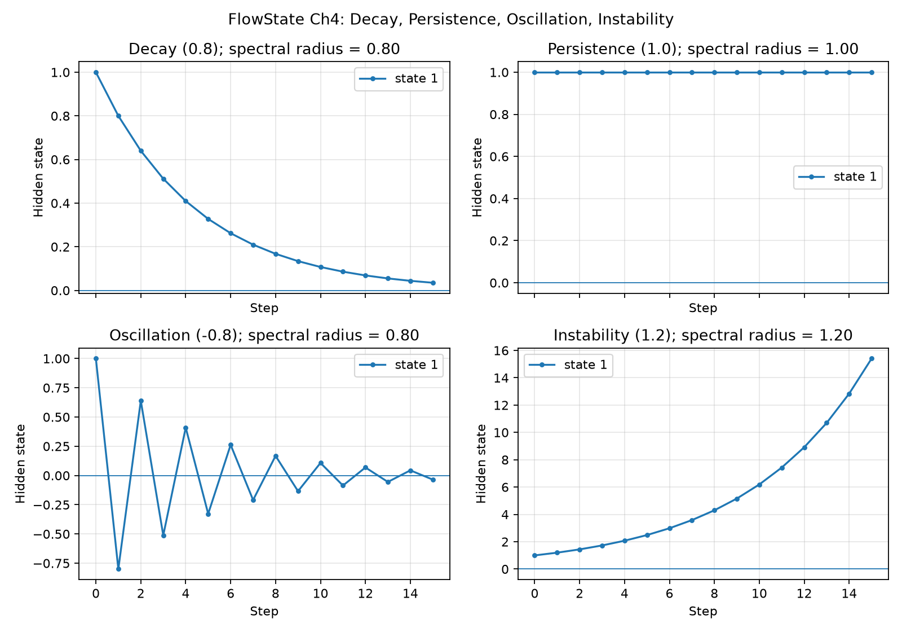
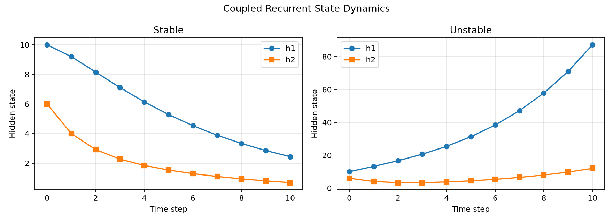
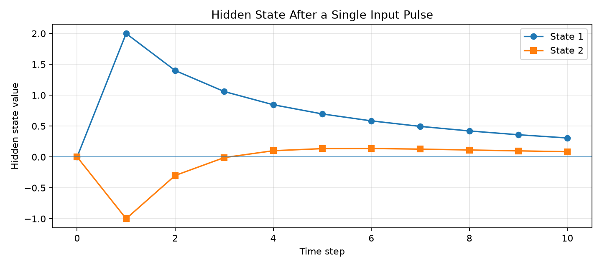

# Chapter 4 — Dynamical Systems for Neural Networks

This chapter explores how recurrent hidden states evolve through time, how interactions between state components influence their trajectories, and how to identify stable and unstable dynamics. It connects elementary linear algebra with the mathematical foundations of recurrent neural networks, state-space models, and continuous-time neural systems.

The experiments use **small, explicitly defined transition matrices** so that numerical results can be checked against hand calculations. They are educational dynamics experiments, not trained language-model benchmarks.

## Concepts

### Discrete-time recurrence

A linear recurrent system evolves as

```math
h_{t+1} = Ah_t
```

where `h_t` is the hidden-state vector and `A` is the state-transition matrix. Repeated updates give `h_n = A^n h_0`.

With incoming observations, the update becomes

```math
h_{t+1} = Ah_t + Bx_t
```

where `B` maps input `x_t` into the state. The influence of a previous input can persist after later inputs have become zero.

### Eigenvalues and stability

The eigenvalues of `A` determine the system's asymptotic behavior. Its spectral radius is

```math
\rho(A) = \max_i |\lambda_i|
```

For the autonomous linear recurrence:

- **`ρ(A) < 1`** — all state trajectories converge toward zero.
- **`ρ(A) > 1`** — at least some initial states lead to unbounded growth.
- **`ρ(A) = 1`** — a boundary case; boundedness requires additional analysis.

The four illustrative cases below show how a state component decays, persists, alternates in sign, or grows under repeated transitions.



*Figure 1. Qualitative stability regimes and their spectral radii, computed from diagonal transition matrices.*

### Continuous-time dynamics

A simple decay process is described by

```math
\frac{dh}{dt} = -\frac{h}{\tau}, \qquad h(t) = h(0)e^{-t/\tau}
```

Euler integration approximates this evolution with

```math
h(t+\Delta t) \approx h(t) + \Delta t\left(-\frac{h(t)}{\tau}\right)
```

The time constant `τ` controls the physical rate of decay; the integration step `Δt` controls numerical approximation resolution. This distinction motivates the numerical solver comparisons in Chapter 5.

## Experiments

| File | Experiment |
| --- | --- |
| `matrix_dynamics.py` | Simulates a coupled two-dimensional recurrence and computes eigenvalues and spectral radius. |
| `matrix_dynamics_growth.py` | Changes one transition coefficient to demonstrate how coupling can produce instability. |
| `input_dynamics.py` | Injects a single input pulse and tracks its effect across later steps. |
| `dynamics_lab.ipynb` | Plots evolving hidden states and compares qualitative stability behaviors. |
| `stability_cases.py` | Creates a four-case visualization of decay, persistence, oscillation, and growth. |

### Stable and unstable coupled recurrences

Starting with

```python
A = [[0.8, 0.2],
     [0.1, 0.5]]
h0 = [10.0, 6.0]
```

the recurrence produces `h1 = [9.2, 4.0]`, `h2 = [8.16, 2.92]`, and `h10 ≈ [2.44325, 0.68695]`. Its spectral radius is approximately **0.8562**, so the autonomous system is asymptotically stable.

Changing only `A[0,0]` from `0.8` to `1.2` gives `h10 ≈ [87.17267, 11.98520]` and spectral radius approximately **1.2275**. Both components ultimately grow for this initial state, illustrating how coupled systems can behave differently from what an individual diagonal coefficient might suggest.



*Figure 2. Matched initial states, with only the first diagonal coefficient changed between runs.*

### Input-driven state propagation

With

```python
A = [[0.8, 0.2], [0.1, 0.5]]
B = [2.0, -1.0]
h0 = [0.0, 0.0]
inputs = [1, 0, 0, 0, 0]
```

the state follows

| Step | State 1 | State 2 |
| ---: | ---: | ---: |
| 0 | 0.0000 | 0.0000 |
| 1 | 2.0000 | -1.0000 |
| 2 | 1.4000 | -0.3000 |
| 3 | 1.0600 | -0.0100 |
| 4 | 0.8460 | 0.1010 |
| 5 | 0.6970 | 0.1351 |

Although no further inputs arrive after step 1, the hidden state continues to evolve. The second component crosses zero because the first component supplies a positive cross-state contribution.



*Figure 3. The first input changes the hidden state; subsequent zero-input steps still propagate its influence through the recurrent transition matrix.*

## Running the examples

From the `chap-4` directory, using a Python environment with **PyTorch**, **NumPy**, and **Matplotlib** installed:

```bash
python matrix_dynamics.py
python matrix_dynamics_growth.py
python input_dynamics.py
python stability_cases.py
```

Open `dynamics_lab.ipynb` in Jupyter or VS Code and select the project's Python kernel to explore the state trajectories visually.

## Key takeaways

1. Hidden-state components can retain and exchange influence across recurrent steps without receiving new input.
2. Stability depends on the **full transition operator**, not just a single coefficient.
3. A negative eigenvalue can cause sign-alternating trajectories; eigenvalue magnitude determines their asymptotic decay or growth in an eigenvector direction.
4. Continuous-time equations describe a process, while numerical integration approximates that process at finite time steps.

**Next:** [Chapter 5 — Numerical ODE Solvers](../chap-5/) will examine Euler, midpoint/RK2 and RK4 methods, including error versus step size and runtime.
