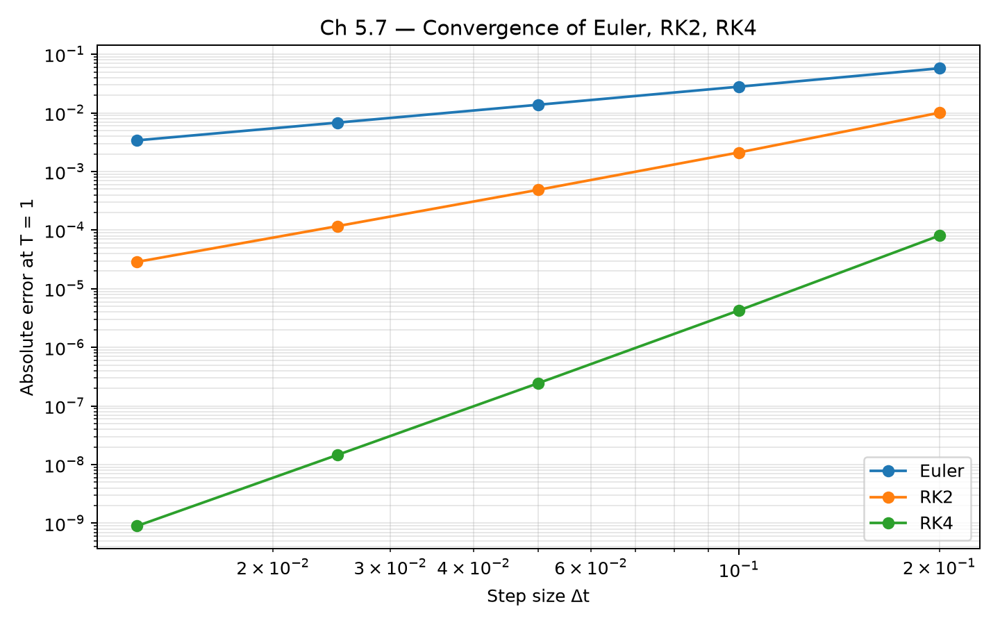
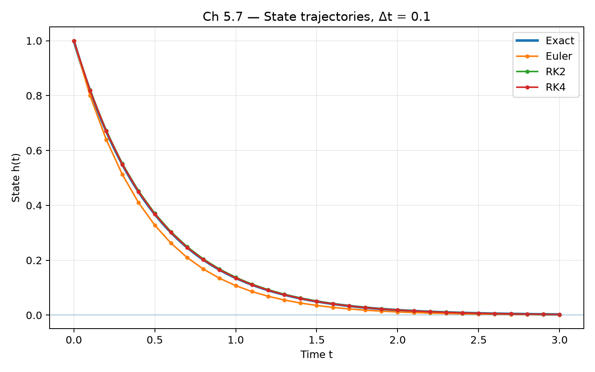
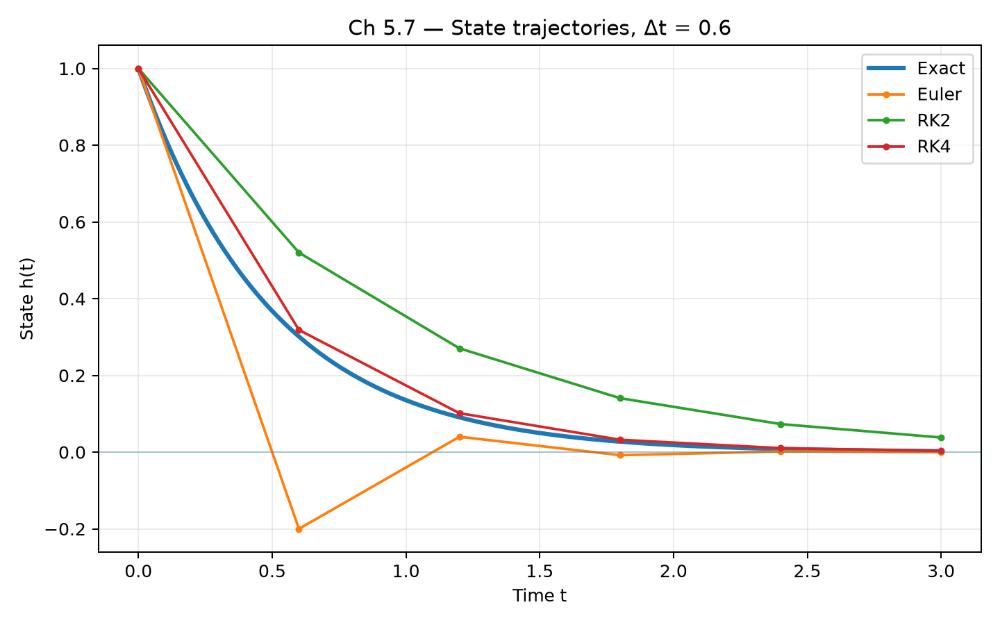
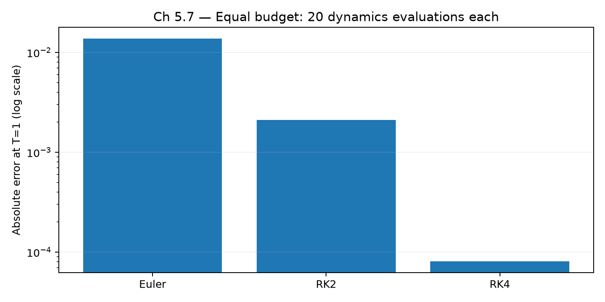

# FlowState Δ — Chapter 5: Numerical ODE Solvers

**Curriculum:** FlowState Research v2.0 · Chapter 5 of 72  
**Study and experiment dates:** 13–14 November 2026 (IST)  
**Scope:** fixed-step numerical integration of simple scalar ordinary differential equations; **not** a trained neural model or a novel LTC/CfC result.

## Research question

How do Euler, explicit-midpoint RK2, and classical RK4 trade off approximation accuracy, numerical stability, dynamics-function evaluations, and CPU runtime on a controlled continuous-time decay problem?

The primary test problem is:

$$
\frac{dh}{dt}=-2h, \qquad h(0)=1, \qquad h(t)=e^{-2t}.
$$

A second ODE, $dh/dt=t$, tests solver time arguments. For $h(0)=0$, its exact solution is $h(t)=t^2/2$. These two tests catch different classes of implementation mistakes.

## Repository contents

| Path | Purpose |
| --- | --- |
| `dynamics.py` | Test equations and matching analytical solutions |
| `solvers.py` | Shared Euler, RK2 midpoint, RK4, and fixed-step `solve()` |
| `01_euler_basics.py` | Euler update and step-size behavior |
| `02_error_scaling.py` | Numerical error at a fixed final time |
| `03_rk2_midpoint.py` | Midpoint RK2 and regression cases |
| `04_rk4.py` | Classical four-slope RK4 and its time arguments |
| `05_stability.py` | Scalar stability multiplier and stable/inaccurate examples |
| `06_cost_tradeoff.py` | Equal-NFE accuracy comparison; counts calls to the dynamics function |
| `06b_runtime_benchmark.py` | Repeated CPU timings, recorded separately from NFE |
| `test_solvers.py` | Seven regression tests, including explicit-time cases |
| `07_final_lab.ipynb` | Final lab: convergence, trajectories, stability, NFE, runtime, exported artifacts |
| `figures/ch5_*.png` | Generated plots from the final lab |
| `figures/ch5_lab_results.json` | Machine-readable numerical results and environment metadata |

Some older exploratory scripts (for example, `rk2.py` and `error_analysis.py`) may also be present locally. The numbered scripts and shared solver module are the **canonical reproducible implementation**. `07_final_lab_TEMPLATE.md`, if retained, is historical scaffolding rather than the completed notebook.

## Methods and definitions

- **Euler:** one dynamics-function evaluation per integration step; global order 1.
- **RK2 (explicit midpoint):** two dynamics-function evaluations per step; global order 2.
- **RK4 (classical):** four dynamics-function evaluations per step; global order 4.
- **NFE:** *number of function evaluations*—how often the solver calls `dynamics(t, h)`. NFE is not model depth, runtime, energy consumption, or number of neural layers.
- **Absolute error:** $|h_{\mathrm{numeric}}(T)-h_{\mathrm{exact}}(T)|$.

Classical convergence orders require sufficiently smooth dynamics and appropriate step sizes. Numerical stability and numerical accuracy are distinct.

## Results

### 1. Convergence at a shared final time

With $T=1$ and $\Delta t\in\{0.2,0.1,0.05,0.025,0.0125\}$, the observed last-halving convergence orders are:

| Solver | Theoretical global order | Observed order (last halving) |
| --- | ---: | ---: |
| Euler | 1 | 1.006 |
| RK2 midpoint | 2 | 2.028 |
| RK4 | 4 | 4.030 |

The observations support the expected convergence trend **for this test ODE**. The last-halving estimate is `log2(error(dt=0.025) / error(dt=0.0125))`, not a general guarantee for arbitrary dynamics.



### 2. State trajectories and stability

All methods solve the same decay equation. At $\Delta t=0.1$, RK4 closely matches the exact trajectory. At $\Delta t=0.6$, Euler alternates sign while shrinking in magnitude; RK2 also decays but remains significantly inaccurate.





For the test equation, each numerical step has scalar multiplier $R(z)$, where $z=-2\Delta t$:

- Euler: $R(z)=1+z$
- RK2: $R(z)=1+z+z^2/2$
- RK4: $R(z)=1+z+z^2/2+z^3/6+z^4/24$

If $|R(z)|<1$, repeated numerical states decay. For $|R(z)|>1$, their magnitude diverges. $|R(z)|=1$ is the stability boundary, not asymptotic decay.

At $T=3$, the exact value is **0.0024787522**:

| Step size | Euler estimate | RK2 estimate | RK4 estimate |
| --- | ---: | ---: | ---: |
| 0.1 | 0.001238 | 0.002597 | 0.002479 |
| 0.6 | -0.000320 | 0.038020 | 0.003272 |
| 1.0 | -1.000000 | 1.000000 | 0.037037 |
| 1.5 | 4.000000 | 6.250000 | 1.890625 |

**Stable but inaccurate:** RK2 at $\Delta t=0.6$ has multiplier $R=0.52$, so its state decays, yet its final estimate 0.038020 differs substantially from the exact value. Thus stability does not mean constant or low error.

**Unstable:** Euler at $\Delta t=1.5$ has multiplier $R=-2$, producing $1\to-2\to4$ after two steps.

### 3. Equal NFE: accuracy per function evaluation

At $T=1$, each configuration uses exactly **20 dynamics evaluations**, checked using a call-counting wrapper:

| Method | Step size | Steps | NFE | Absolute error |
| --- | ---: | ---: | ---: | ---: |
| Euler | 0.05 | 20 | 20 | 0.013758629 |
| RK2 | 0.10 | 10 | 20 | 0.002112748 |
| RK4 | 0.20 | 5 | 20 | 0.000080731 |

Here, RK4 has approximately **26×** less absolute error than RK2 and **170×** less than Euler at equal NFE. This comparison does **not** establish that RK4 is the fastest or most accurate solver for all ODEs.



### 4. CPU microbenchmark (student-reported run)

On the student's Ubuntu Python environment on **14 November 2026**, a simple `time.perf_counter()` benchmark with 200 warm-ups and seven batches of 2,000 solves reported:

| Method | Median µs/solve | Min µs | Max µs |
| --- | ---: | ---: | ---: |
| Euler | 5.375 | 5.008 | 6.333 |
| RK2 | 5.537 | 5.222 | 6.219 |
| RK4 | 4.876 | 4.809 | 5.269 |

RK4 had the smallest median in **that run**. The ranges overlap, the dynamics are trivial, and these microsecond-scale Python timings are sensitive to interpreter and system overhead. Do not extrapolate the ranking to GPU, smartphone inference, or learned neural dynamics.

## Reproduce

From the **repository root**, using the project's Python virtual environment:

```bash
python --version
python -m unittest discover -s chap-5 -p 'test_*.py' -v
python chap-5/01_euler_basics.py
python chap-5/02_error_scaling.py
python chap-5/03_rk2_midpoint.py
python chap-5/04_rk4.py
python chap-5/05_stability.py
python chap-5/06_cost_tradeoff.py
python chap-5/06b_runtime_benchmark.py
```

The solver scripts use only Python's standard library. The final lab requires `matplotlib`, `ipykernel`, and a compatible Jupyter environment:

```bash
python -m pip install matplotlib ipykernel nbconvert
cd chap-5
jupyter nbconvert --to notebook --execute --inplace 07_final_lab.ipynb
```

The executed notebook writes plots and `figures/ch5_lab_results.json`. Check all notebook cells for exceptions, save the notebook, and retain its final interpretation section before committing. The data are deterministic except for measured wall-clock timing; no random seed is needed for the scalar dynamics tests.

## Validation and debugging lessons

Seven automated solver checks passed in the student's reported Ubuntu execution. The notebook's additional consistency checks and graphs were displayed in the student-provided VS Code screenshots. The shared module was independently examined for correct RK2/RK4 evaluation times and recomputed convergence metrics; final publication still requires a fresh local rerun and Git review.

Two original programming mistakes illustrate why multiple test equations matter:

1. An RK2 midpoint incorrectly used `t + dt` rather than `t + dt/2`.
2. An RK4 endpoint incorrectly used `t + dt/2` rather than `t + dt`.

The decay ODE ignores its explicit time argument, so these mistakes could pass the decay-only test. The separate equation $dh/dt=t$ exposed them. A different mistake occurred when a time-dependent result was compared against the analytical solution of the decay equation: reference and tested dynamics must always match.

## Limitations and next research steps

- Only elementary scalar ODEs were tested; no stiff ODEs, nonlinear neural dynamics, multi-dimensional hidden states, or training gradients were benchmarked.
- Results concern **fixed-step explicit** Euler, RK2 and RK4; adaptive solvers and stiff solvers were not compared.
- Equal NFE does not guarantee equal latency, memory usage, or energy consumption.
- Reported CPU timing is a local teaching benchmark, not a hardware-neutral performance claim.
- No original architecture or publication-level neural-network finding is claimed.

**Next in the original 72-chapter curriculum:** brief signals-and-systems prerequisites, then Chapter 6 — Liquid Time-Constant Networks (LTC). Future experiments can compare numerical error, runtime, stability and task performance for controlled learned recurrent dynamics, using reproducible baselines.
