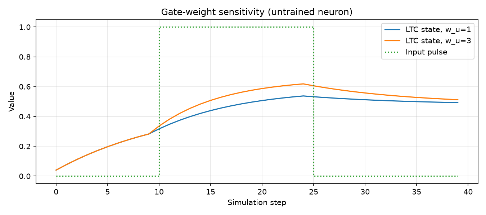
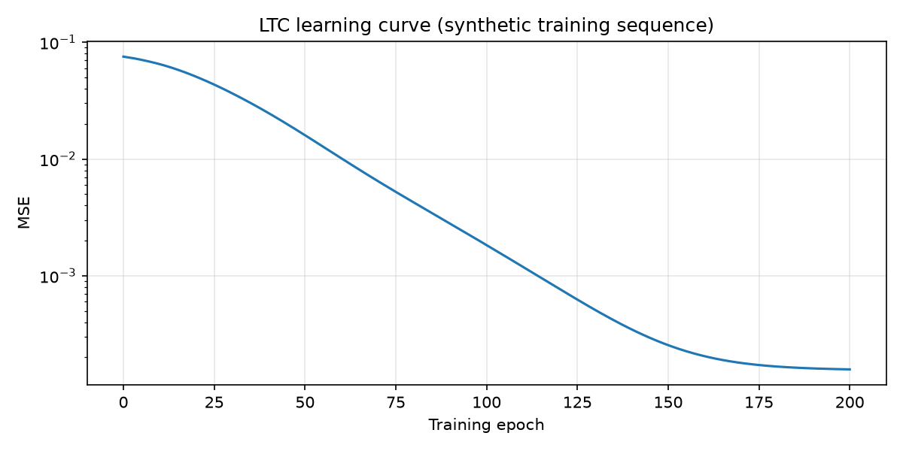
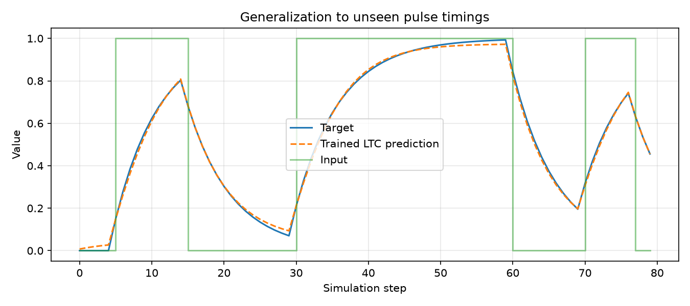
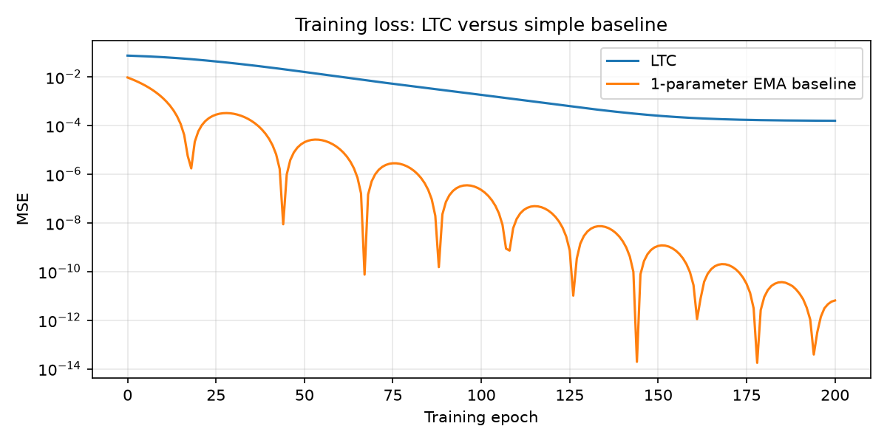

# Chapter 6 — Liquid Time-Constant Networks (LTC)

> FlowState Δ · Phase I: Mathematical Foundations & Liquid Core  
> Status: **Introductory educational lab complete; published LTC reproduction not attempted**  
> Experimental scope: scalar LTC-style cell, synthetic pulse sequences, CPU.

## Research question

Can a scalar neuron with a learned input/state-dependent gate approximate temporal dynamics? How does its behavior compare to a fixed-coefficient recurrence, and what numerical-solver limitations arise?

## What is implemented

- `ltc_neuron.py` — initial LTC-style scalar simulation; input pulse; gate-weight sensitivity.
- `ltc_train.py` — 80-step pulse-sequence fitting with BPTT and Adam; unseen-pulse sanity check.
- `ltc_stability.py` — frozen-gate linear ODE; Euler versus RK4 versus analytical solution.
- `FlowState_Ch06_LTC_Lab.ipynb` — consolidated, executable lab: derivations, tests, model training, EMA baseline, numerical stability and research memo.
- `chapter6_outputs/` — figures and machine-readable experiment outputs generated by the notebook.

The cell is **LTC-inspired**, not a faithful multi-neuron reimplementation of the original LTC architecture. Reproduction of published LTC/CfC experiments is scheduled for Chapter 8.

## Mathematical core

For hidden state `x`, input `u` and nonnegative nonlinear gate `f(x,u)`:

```text
dx/dt = -x/tau + f(x,u) * (A - x)
f(x,u) = sigmoid(w_x*x + w_u*u + bias)
tau_eff = 1 / (1/tau + f(x,u))
x_next = x + dt*(dx/dt)              # explicit Euler
```

For the synthetic supervised task, targets come from a fixed exponential moving average (EMA):

```text
y_next = 0.85*y + 0.15*u
```

## Reproduce locally

From the FlowState repository root, activate your existing environment with PyTorch, NumPy, Matplotlib and Jupyter installed:

```bash
cd chap-6
python ltc_neuron.py
python ltc_train.py
python ltc_stability.py
jupyter lab FlowState_Ch06_LTC_Lab.ipynb
```

Alternatively, open the notebook in VS Code, select your Python environment and choose **Run All**. The notebook writes figures to `chap-6/chapter6_outputs/` when launched from `chap-6`. All notebook paths are relative to the working directory.

## Observed results

These numbers are from the single-seed, 80-step **synthetic** exercise (seed 42, Adam learning rate 0.03, 201 epochs, CPU).

| Metric | Result |
|---|---:|
| Initial LTC training MSE | 0.075411 |
| Final LTC training MSE | 0.000158 |
| LTC unseen-pulse test MSE | 0.000141 (notebook: 0.00014072) |
| LTC-style trainable parameters | 5 |
| EMA baseline trainable parameters | 1 |
| EMA baseline test MSE | Approximately 0 |

The 1-parameter EMA reproduces the target almost exactly because the target **was generated by that EMA rule**. The LTC-style cell learns an approximation, not a demonstrated advantage. The unseen pulse sequence changes pulse timing but **not** the target-generating law.

### Numerical solver sanity check

Frozen-gate case `tau=2`, `f=0.5`, `A=1`, `x(0)=0` yields `dx/dt = 0.5 - x` and exact solution `x(t)=0.5*(1-exp(-t))`.

| Step size | Euler after 8 | RK4 after 8 | Exact after 8 |
|---:|---:|---:|---:|
| 0.1 | 0.28477 | 0.27534 | 0.27534 |
| 1.0 | 0.50000 | 0.49980 | 0.49983 |
| 2.0 | 0.00000 | 0.49992 | 0.50000 |
| 2.5 | -12.31445 | 0.48437 | 0.50000 |

At `h=2.5`, explicit Euler diverges while RK4 stays bounded but remains inaccurate. **Stability and accuracy are distinct**, and neither numerical method is universally optimal.

## Figures

After executing the notebook, its generated figures can be viewed here:

| Figure | What it shows |
|---|---|
|  | Input gate weight affects response speed and peak state |
|  | Training MSE by epoch (log scale) |
|  | Trained LTC prediction versus target on new pulse timings |
|  | Simple one-parameter EMA baseline versus LTC training |

The notebook also generates Euler/RK4 stability figures in `chapter6_outputs/`. Keep figures generated from code; don't commit desktop screenshots in place of figure exports.

## Research decision

**UNKNOWN — architectural advantage unproven.** This educational experiment establishes that a trainable scalar LTC-style neuron can model a smooth temporal response; it does not show better accuracy, speed, memory or energy use than simpler models.

**Next falsifiable question:** On sequences requiring *input-dependent* response speeds, can LTC-style dynamics achieve lower held-out error than EMA, vanilla RNN and GRU at comparable training and resource budgets?

### Limitations and next steps

- Synthetic data, one seed and a small fixed target law; no real-world task.
- Scalar toy, not a faithful full LTC or matched RNN/GRU implementation.
- No multiple-seed uncertainty, runtime/memory/energy benchmark, or measured edge deployment.
- Chapter 7 investigates CfC; Chapter 8 is for a documented reproduction of published LTC/CfC experiments.

## Reference

Hasani et al., [*Liquid Time-constant Networks*](https://arxiv.org/abs/2006.04439), AAAI 2021. This lab follows **FlowState Research Curriculum v2.0, Chapter 6**, October 2026.
