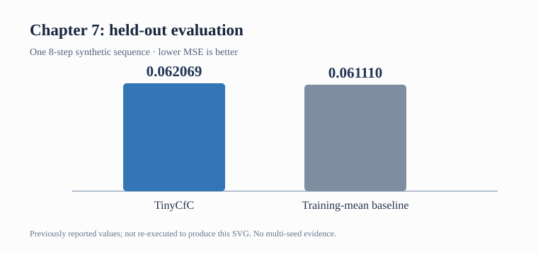
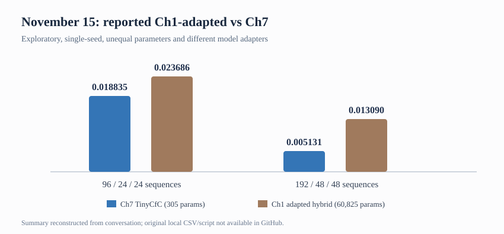

# Chapter 7 — Closed-form Continuous-time (CfC) teaching lab

> **FlowState Δ, Phase I · introductory educational scope complete (16 Nov 2026).**  
> A small, **CfC-inspired** recurrent state-update lab; **not a faithful reproduction** of the published architecture, its benchmark suite, or evidence of an architecture advantage. Full LTC/CfC reproduction and controlled baselines belong to Chapter 8.

## Question and mathematical mechanism

How can elapsed time affect a recurrent neural state transition without running a numerical ODE solver at every update? Compare the exact update for a **frozen-coefficient** first-order ODE,

```text
dy/dt = -(y - u)
y_next = u + (y_previous - u) * exp(-dt)
```

with a *learned* CfC-style interpolation in this chapter:

```text
z = tanh(W_backbone * concat(x_previous, u) + b)
f = Linear_f(z)            # unconstrained values, not necessarily positive
g = tanh(Linear_g(z))
h = tanh(Linear_h(z))
alpha = sigmoid(-f * dt)
x_next = alpha * g + (1 - alpha) * h
```

This version uses a 16-feature backbone, four-dimensional state, three distinct 4-feature heads (f/g/h), and a one-dimensional scalar readout. The cell has **300** trainable parameters; cell plus readout has **305**. It is *inspired by Equation 10* of Hasani et al., not an exact universal solution to nonlinear LTC equations. `dt` changes the time gate; during standard inference, the weights remain fixed and the recurrent state changes.

## Files

| File | Purpose |
| --- | --- |
| [cfc_cell.py](cfc_cell.py) | Original student-written CfC-inspired cell; interval sensitivity, shapes and gradients (note: also runs a smoke test on import) |
| [temporal_target.py](temporal_target.py) | Analytical first-order response and target sequence smoke checks |
| [train_cfc.py](train_cfc.py) | Six-step training, eight-step held-out evaluation, constant-predictor baseline |
| [FlowState_Ch07_CfC_Lab.ipynb](FlowState_Ch07_CfC_Lab.ipynb) | **New**, run-all notebook: equations, model, fresh training, held-out comparison, exportable figures and JSON |
| [compare_ch1_ch7.py](compare_ch1_ch7.py) | **New** fresh Ch1-adapted numeric model vs Ch7 batched CfC probe with shared synthetic data; **not** the lost original local script |
| [results/ch1_ch7_reported_summary.csv](results/ch1_ch7_reported_summary.csv) | **Reconstructed historical summary** from user-reported Nov 15 outputs, **not original raw CSV** |
| [figures/ch7_heldout_reported.svg](figures/ch7_heldout_reported.svg) | Historical held-out-vs-constant result, clearly provenance-labeled |
| [figures/ch1_ch7_reported.svg](figures/ch1_ch7_reported.svg) | Historical Ch1-adapted vs Ch7 result, clearly provenance-labeled |

## Run the educational lab

Requires Python, PyTorch and Matplotlib. The notebook additionally needs Jupyter/VS Code's notebook environment.

```bash
# From repository root
cd chap-7
python cfc_cell.py
python temporal_target.py
python train_cfc.py
# Open FlowState_Ch07_CfC_Lab.ipynb in Jupyter / VS Code and Run All
```

The notebook creates *fresh* outputs in `figures/rerun_training_loss.png`, `figures/rerun_heldout.png`, and `results/ch7_notebook_rerun.json` after you execute it. These generated outputs are **not pre-claimed as committed results**.

For the separate **new** Ch1-adapted comparison, run from the **repository root**:

```bash
python chap-7/compare_ch1_ch7.py --epochs 6 --seeds 42
# Optional stronger exploratory check
python chap-7/compare_ch1_ch7.py --epochs 10 --seeds 1,2,3
```

This exports `chap-7/results/ch1_ch7_fresh.csv`. It uses Chapter 1's actual GatedDeltaNet/GQA **blocks**, but replaces the LM embedding/head with a numeric-input regression adapter (16-dimension, 3 GatedDeltaNet + 1 GQA), so it is **not** the original Chapter 1 LM. Both models use identical new data splits, MSE loss, optimizer and epochs, but **not** matched model capacity or compute. It is not an architecture bake-off; compare task, parameter count and training budget before interpreting outputs. The original Nov 15 script and raw `comparison_results.csv` were only present locally, not on the repository; see the reconstructed summary below.

## Recorded Chapter 7 single-sequence outcome

The following values were **reported from student terminal execution** during the 15–16 Nov teaching session; they have not been independently rerun in the new notebook:

| Metric | MSE |
| --- | ---: |
| TinyCfC training (6 data points) | 0.000173 |
| TinyCfC held-out (8 data points) | 0.062069 |
| Constant train-target-mean baseline on held-out sequence | 0.061110 |



The tiny training error does **not** establish generalization; on this held-out sequence TinyCfC performs slightly **worse** than a trivial training-mean predictor. One holdout is insufficient for broad claims. Local solver truncation error is distinct from model approximation error and prediction error. The original training code uses four-decimal training targets and a single seeded initialization; notebooks may produce different measured numbers if run under different initialization circumstances.

## Nov 15 — reported Chapter 1-adapted vs Chapter 7 experiment

Earlier we created a local `compare_ch1_ch7.py` and `comparison_results.csv` on the student's laptop. Neither exists in the committed `main` snapshot, so **their exact contents are not recoverable here**. The table below **reconstructs only the numbers the student reported in chat**. Do not confuse it with fresh experiments produced by the new comparison script.

| Split (train/validation/test) | Reported epochs | Ch7 TinyCfC (305 params) test MSE | Ch1 adapted hybrid (60,825 params) test MSE |
| --- | ---: | ---: | ---: |
| 96/24/24 sequences | 8 | 0.018835 | 0.023686 |
| 192/48/48 sequences, 16 steps each | 10 | 0.005131 | 0.013090 |



**Limitations:** single-seed reporting; unequal parameter counts, different model adapters and potentially unequal computational cost; no verified original local data generator, hyperparameters, raw losses or seeds; synthetic first-order data only. **These results do not prove CfC beats transformers, GatedDeltaNet, or hybrid models.**

## Paper reading P0 and interpretation

**Source:** R. Hasani et al., “Closed-form continuous-time neural networks,” *Nature Machine Intelligence* 4 (2022), DOI [10.1038/s42256-022-00556-7](https://doi.org/10.1038/s42256-022-00556-7); [preprint](https://arxiv.org/pdf/2106.13898).

The article motivates a continuous-time architecture whose transition avoids repeated ODE solver iterations. It approximates the relevant LTC dynamics under stated restrictions and constructs trainable time-dependent gating with shared backbone and f/g/h heads. The published experiments report accuracy/speed trade-offs on the authors' tasks; **our tiny experiment has not reproduced those claims**. The formal source-grounded P0 note is in the [Chapter 7 Notion record](https://app.notion.com/p/419a9f53b51981539b77c14771602e27). The note was mentor-assisted; the user personally did a first reading and discussed it.

### Transfer to Chapter 8

Chapter 8 will inspect published LTC/CfC methods, specify faithful reproduction and **controlled** comparisons: matching tasks/splits/compute or parameter budgets, multiple seeds, accuracy, memory, function evaluations and measured time. Do not carry over our Chapter 1-vs-7 exploratory advantage as a research claim. Nishant N1-S1 is a separate paper-inspired side experiment, **not** this chapter's benchmark.
