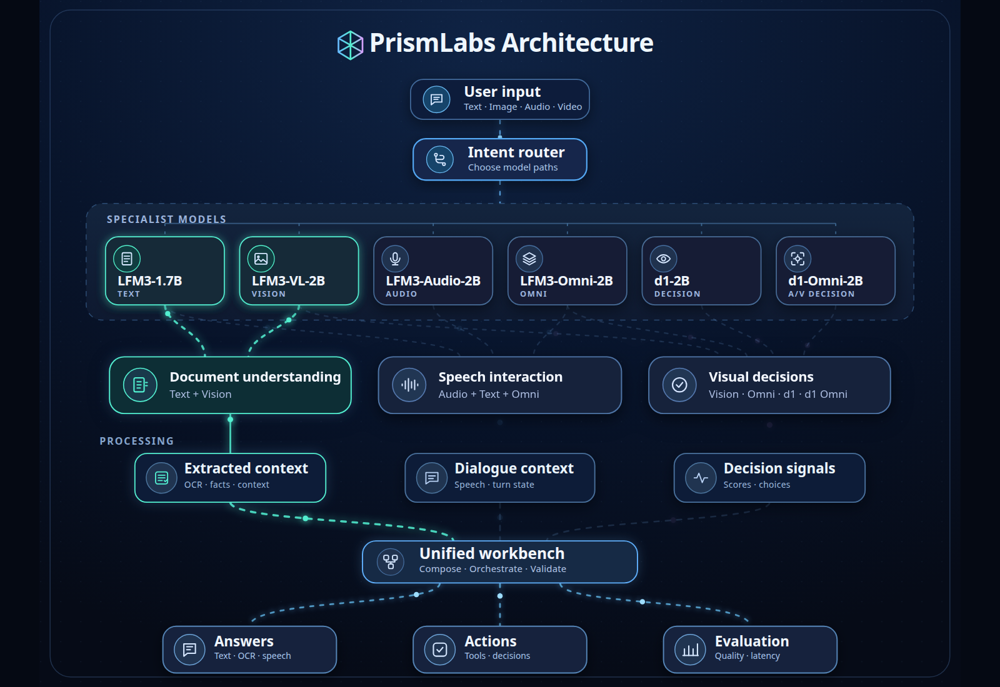
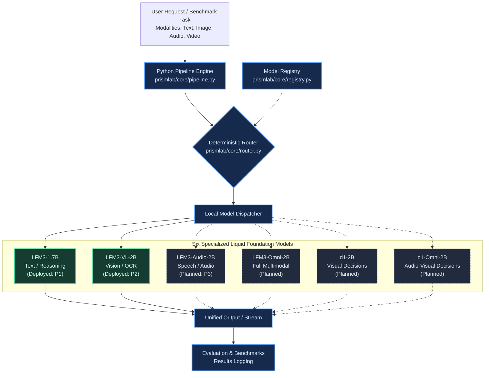

# PrismLab — LFM3 Multimodal Inference & Research Workbench

**PrismLab** is an independent, air-gapped experimental workbench designed to evaluate, benchmark, and route Liquid AI's **Liquid Foundation Model (LFM3)** family under quantized, local CPU execution using `llama.cpp`.

PrismLab operates with **zero cloud dependencies, zero inference costs, and deterministic routing**.

---

## 1. System Architecture

PrismLab uses a deterministic capability-matching router (`prismlab/core/router.py`) rather than non-deterministic LLM-based agent dispatch. Requests are analyzed by task category and input modality subsets, then dispatched across specialized model pathways in the shared LFM pool:

<p align="center">
  <a href="visuals/PrismLabs_Architecture_Extended.html">
    
  </a>
</p>

<p align="center">
  <em>Figure 1: PrismLab Extended Multi-Model Routing & Processing Architecture. Click image to open the <a href="visuals/PrismLabs_Architecture_Extended.html">interactive HTML view</a> or explore the <a href="visuals/PrismLabs_Architecture_Extended.ipynb">Jupyter source notebook</a>.</em>
</p>

<details>
<summary><b>View Pure Mermaid Routing Topology</b></summary>


</details>

---

## 2. Six-Model Registry & Deployment Status

PrismLab registers six model pathways. **To maintain research integrity, registered models are strictly distinguished from models actually deployed and tested:**

| Model Key | Target Model | Inputs | Outputs | Phase Status | Live Deployment |
| :--- | :--- | :--- | :--- | :--- | :--- |
| **`text`** | `LiquidAI/LFM3-1.7B` | `{text}` | `{text}` | **P1 Complete** | **Active (Port 8080)** |
| **`vision`** | `LiquidAI/LFM3-VL-2B` | `{text, image, video}` | `{text}` | **P2 Complete** | **Active (Port 8180)** |
| **`audio`** | `LiquidAI/LFM3-Audio-2B` | `{text, audio}` | `{text, speech}` | **P3 Planned** | *Registered / Not Deployed* |
| **`omni`** | `LiquidAI/LFM3-Omni-2B` | `{text, image, video, audio}` | `{text, speech}` | Subsequent | *Registered / Not Deployed* |
| **`d1`** | `LiquidAI/d1-2B` | `{text, image, video}` | `{decision}` | Subsequent | *Registered / Not Deployed* |
| **`d1_omni`** | `LiquidAI/d1-Omni-2B` | `{text, image, video, audio}` | `{decision}` | Subsequent | *Registered / Not Deployed* |

---

## 3. Completed Research Tracks

### [Phase 1: Deterministic Router & Text Client](docs/p1/README.md)
- Constructed the 6-model registry and deterministic capability router.
- Formally validated 7 router assertions in `tests/test_router.py`.
- Built Python HTTP client for `LFM3-1.7B` running via `llama-server`.
- Procedural Manim architecture animation: [`visuals/manim/PrismLabP1Architecture.mp4`](visuals/manim/PrismLabP1Architecture.mp4).

### [Phase 2: Vision-Language & Comparative OCR Benchmark](docs/p2/README.md) — *Highest Priority*
- Evaluated `LFM3-VL-2B` under quantized CPU execution.
- **Resolution Ablation:** Halving resolution ($0.50\times$) reduced TTFT by **45.3%** (28.01s $\to$ 15.33s) with 100% character legibility on headers.
- **10-Image OCR Benchmark:**
  - Direct VL: **10 / 10 exact matches (100%)**, median latency **38.53 s**.
  - Sequential Pipeline (VL OCR $\to$ Text): **9 / 10 exact matches (90%)**, median latency **65.72 s**.
  - Pipeline Failure Analysis: Cascade failure on `04_lab_schedule.png` was caused by generation token exhaustion in the secondary text model, despite 100% visual OCR phrase recall.
  - Keyword-Conditioned Selection: **5 / 10 strict exact matches** (clarified: 50% strict score was due to retrieval omissions and formatting, not model factual error).

---

## 4. Getting Started

### 4.1 Environment Setup

Install PrismLab in editable development mode:

```bash
cd lfm3-prismlab
pip install -e .
```

### 4.2 Starting Local `llama.cpp` Servers

Launch the quantized Liquid AI models using `llama-server`:

```bash
# Terminal 1: Vision Server (LFM3-VL-2B on port 8180)
llama-server -hf LiquidAI/LFM3-VL-2B-GGUF:Q4_0 \
  --alias lfm3-vision --host 127.0.0.1 --port 8180 -c 2048 -ngl 0 \
  --no-reasoning-preserve

# Terminal 2: Text Server (LFM3-1.7B on port 8080)
llama-server -hf LiquidAI/LFM3-1.7B-GGUF:Q4_K_M \
  --alias lfm3-text --host 127.0.0.1 --port 8080 -c 2048 -ngl 0
```

### 4.3 Python API Quickstart

```python
from prismlab.core.pipeline import run_task

# 1. Text Inference (routed to LFM3-1.7B)
response = run_task(
    prompt="Explain key-value caching in two sentences.",
    task="chat",
    inputs={"text"}
)
print(response)

# 2. Vision Inference (routed to LFM3-VL-2B)
answer = run_task(
    prompt="Read the entry code on the event poster.",
    task="chat",
    inputs={"text", "image"},
    image="data/synthetic_ocr/images/01_event_poster.png"
)
print("Vision Answer:", answer)
```

---

## 5. Repository Layout

```text
lfm3-prismlab/
├── benchmarks/             # Reproducible evaluation & plotting scripts
├── data/                   # Synthetic benchmark datasets & test images
├── docs/                   # Research reports & verified figures
│   ├── p1/                 # Phase 1 documentation & router assertions
│   ├── p2/                 # Phase 2 complete research report & figures
│   └── benchmarks/         # Synthetic OCR suite specifications
├── experiments/            # Exploratory research & probe scripts
├── notebooks/              # Interactive Jupyter research notebooks
├── prismlab/               # Core importable Python package
│   ├── core/               # Registry, deterministic router, pipeline
│   ├── text/               # LFM3-1.7B client
│   └── vision/             # LFM3-VL-2B client & preprocessors
├── results/                # Preserved original CSV, JSON & JSONL records
├── tests/                  # Offline unit tests
└── visuals/                # Mermaid diagrams and Manim animations
```

---

## 6. Testing & Reproducibility

Execute all offline test suites:

```bash
# 1. Test deterministic model router (7 assertions)
python tests/test_router.py

# 2. Test vision payload encoding and message schema
python tests/test_vision_payload.py

# 3. Test multimodal pipeline dispatch (mocked offline)
python tests/test_pipeline.py

# 4. Re-plot benchmark figures from verified CSVs
python benchmarks/plot_results.py
```

---

## 7. Research Documentation Index

- [P1: Core Routing & Local Text Inference Report](docs/p1/README.md)
- [P2: Vision-Language & OCR Benchmark Report (Highest Priority)](docs/p2/README.md)
- [Synthetic OCR Evaluation Suite Specification](docs/benchmarks/ocr_suite.md)
- [Architecture Visualizations & Manim Catalog](visuals/README.md)
