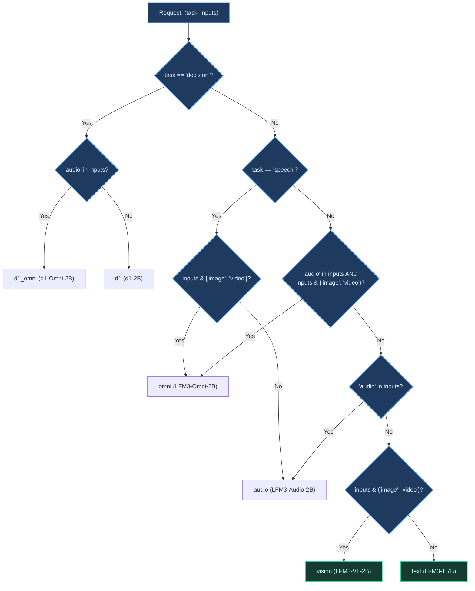

# PrismLab — Phase 1: Deterministic Model Routing & Local Text Inference

**Phase:** P1 — Core Routing & LFM3-1.7B Text Inference  
**Status:** Complete  
**Models Evaluated:** Liquid AI LFM3-1.7B (GGUF `Q4_K_M`)  
**Runtime:** `llama-server` on local CPU (`port 8080`)  

---

## 1. Abstract & Objectives

Phase 1 established the architectural foundation of PrismLab: an air-gapped, zero-cost, local model router and inference client. The primary goal was to construct a deterministic capability-matching router capable of mapping incoming tasks and arbitrary input modality subsets to specialized members of the Liquid Foundation Model (LFM3) family.

Rather than relying on non-deterministic LLM-based agent dispatch, PrismLab employs set-theoretic capability matching ($I \subseteq \text{inputs}$) with strict fallback rules. In P1, local inference for `LFM3-1.7B` was brought online using `llama.cpp`'s HTTP server, accompanied by a Python streaming client with zero external dependencies.

---

## 2. Six-Model Registry & Modality Topology

PrismLab defines a formal registry of six model pathways (`prismlab/core/registry.py`):

| Model Key | HuggingFace Repository | Supported Inputs | Supported Outputs | Deployment Status |
| :--- | :--- | :--- | :--- | :--- |
| **`text`** | `LiquidAI/LFM3-1.7B` | `{text}` | `{text}` | **Deployed & Tested (P1)** |
| **`vision`** | `LiquidAI/LFM3-VL-2B` | `{text, image, video}` | `{text}` | **Deployed & Tested (P2)** |
| **`audio`** | `LiquidAI/LFM3-Audio-2B` | `{text, audio}` | `{text, speech}` | *Registered (Planned P3)* |
| **`omni`** | `LiquidAI/LFM3-Omni-2B` | `{text, image, video, audio}` | `{text, speech}` | *Registered (Planned)* |
| **`d1`** | `LiquidAI/d1-2B` | `{text, image, video}` | `{decision}` | *Registered (Planned)* |
| **`d1_omni`** | `LiquidAI/d1-Omni-2B` | `{text, image, video, audio}` | `{decision}` | *Registered (Planned)* |

---

## 3. Deterministic Routing Architecture

The router (`prismlab/core/router.py`) maps `(task, inputs)` tuples to exact model identifiers according to hierarchical rule evaluation:



### Validated Router Assertions

The deterministic routing logic is formally verified by 7 assertions in `tests/test_router.py`:

```python
cases = [
    ("chat", {"text"}, "text"),
    ("chat", {"text", "image"}, "vision"),
    ("chat", {"audio"}, "audio"),
    ("chat", {"audio", "image"}, "omni"),
    ("decision", {"text", "image"}, "d1"),
    ("decision", {"audio"}, "d1_omni"),
    ("speech", {"text"}, "audio"),
]
```

All 7 assertions pass synchronously with zero heuristic ambiguity.

---

## 4. Local Text Inference & Server Integration

### Server Setup

Inference runs locally using `llama-server` with CPU threading and zero GPU offloading (`-ngl 0`):

```bash
cd ~/Desktop/llama.cpp
./build/bin/llama-server -hf LiquidAI/LFM3-1.7B-GGUF:Q4_K_M \
  --alias lfm3-text --host 127.0.0.1 --port 8080 -c 2048 -ngl 0
```

### Client Architecture

The Python client (`prismlab/text/client.py`) interfaces with `llama-server` via standard OpenAI-compatible endpoints (`/v1/chat/completions`):
- Pure standard library implementation using `urllib.request`.
- Environment-variable configuration (`PRISMLAB_TEXT_API`, default `http://127.0.0.1:8080/v1/chat/completions`).
- Automatic `<think>` and `</think>` token handling to support reasoning and non-reasoning generation modes.

---

## 5. Demonstration Visuals

The procedural Manim animation illustrating request intake, deterministic dispatch, and local token generation is stored as:

- **Release Animation:** [`../../visuals/manim/PrismLabP1Architecture.mp4`](../../visuals/manim/PrismLabP1Architecture.mp4)
- **Interactive Explainer:** [`../../visuals/manim/PrismLab_P1_Live_Glow_Architecture.html`](../../visuals/manim/PrismLab_P1_Live_Glow_Architecture.html)

---

## 6. Limitations & Transition to P2

- **Modality Scope:** P1 was strictly text-in, text-out. Requests requiring vision, audio, or visual decision-making were routed to their theoretical endpoints but threw `NotImplementedError` at execution time.
- **Single Model Process:** P1 tested single-server deployment. Orchestrating multi-model inference pipelines (e.g., Vision $\to$ Text) required dual-port management, which was introduced in Phase 2.
