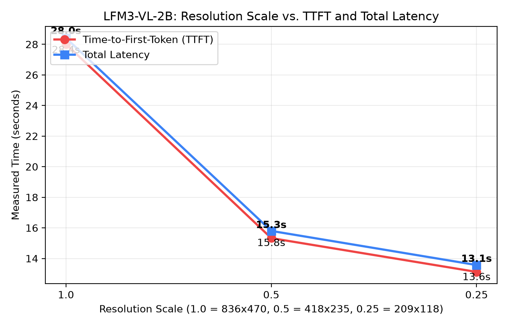
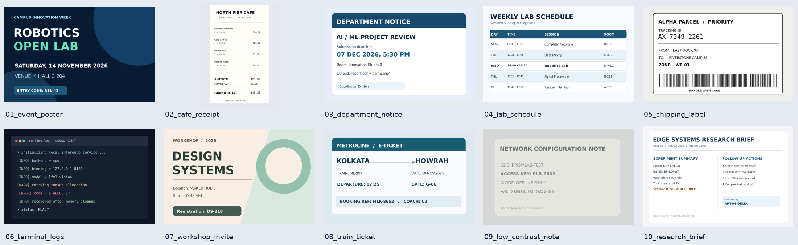
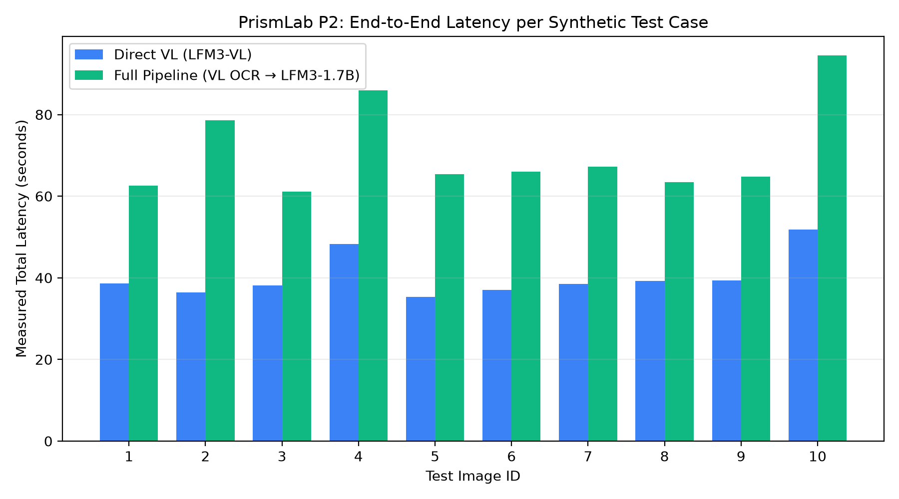
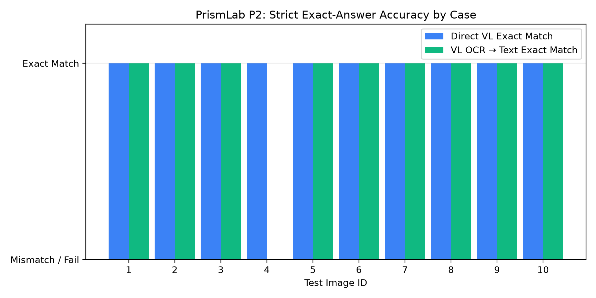
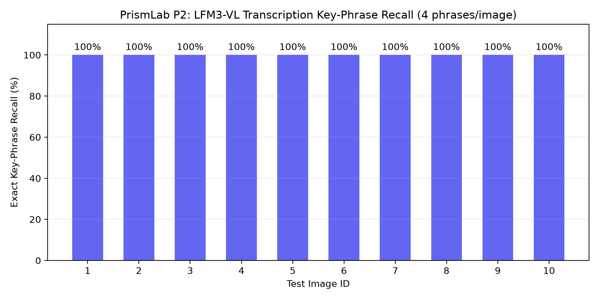

# PrismLab — Phase 2: Local Vision-Language Inference, Resolution Ablation & OCR Benchmarks

**Phase:** P2 — Multimodal Vision-Language Integration & Comparative OCR Pipelines  
**Status:** Completed & Empirically Verified  
**Evaluated Models:** Liquid AI `LFM3-VL-2B` (GGUF `Q4_0`) & `LFM3-1.7B` (GGUF `Q4_K_M`)  
**Runtime:** Dual `llama-server` instances on local CPU (Ports `8180` and `8080`)  
**Datasets:** NIRANTAR Infographic & 10-Case Synthetic Document Benchmark  

---

## 1. Abstract & Objectives

Phase 2 investigated the empirical behavior, throughput, and transcription fidelity of local multimodal foundation models running on commodity CPU hardware. Specifically, we evaluated Liquid AI's `LFM3-VL-2B` across two core architectural paradigms:

1. **Direct End-to-End Vision-Language QA:** Image + question $\to$ `LFM3-VL-2B` $\to$ final answer in a single forward pass.
2. **Two-Stage Sequential Pipeline (VL OCR $\to$ Text Reasoning):** Image $\to$ `LFM3-VL-2B` (transcription) $\to$ raw OCR text $\to$ `LFM3-1.7B` (reasoning & answer extraction) $\to$ final answer.

We sought to answer four core questions:
- How does input image resolution impact Time-to-First-Token (TTFT) and total generation latency under quantized CPU inference?
- Does decomposing multimodal QA into separate perception and reasoning stages improve strict exact-answer accuracy?
- What failure modes emerge at the interface between vision-language perception and downstream text reasoning?
- How does naive keyword-conditioned evidence selection compare against passing uncompressed OCR transcripts?

> **Scientific Caveat:** The measurements reported herein represent a controlled, synthetic pilot study ($N=10$). They characterize architectural mechanics, latency trade-offs, and failure modes under CPU-bound execution; they do not constitute generalized claims of commercial OCR superiority or statistical model superiority.

---

## 2. Experimental Environment & Server Topology

Inference was conducted purely on CPU threads with zero GPU offloading (`-ngl 0`). Dual `llama-server` instances were orchestrated on separate localhost ports to prevent port contention:

```text
[ Client Application / Benchmark Harness ]
             │                       │
      (Port 8180: Vision)     (Port 8080: Text)
             ▼                       ▼
  ┌───────────────────────┐  ┌───────────────────────┐
  │ llama-server: 8180    │  │ llama-server: 8080    │
  │ Model: LFM3-VL-2B     │  │ Model: LFM3-1.7B      │
  │ Quant: Q4_0           │  │ Quant: Q4_K_M         │
  │ Context: 2048         │  │ Context: 2048         │
  │ Threads: CPU native   │  │ Threads: CPU native   │
  └───────────────────────┘  └───────────────────────┘
```

### Server Invocation Commands

```bash
# Terminal 1: Vision Server (LFM3-VL-2B)
cd ~/Desktop/llama.cpp
./build/bin/llama-server -hf LiquidAI/LFM3-VL-2B-GGUF:Q4_0 \
  --alias lfm3-vision --host 127.0.0.1 --port 8180 -c 2048 -ngl 0 \
  --no-reasoning-preserve

# Terminal 2: Text Server (LFM3-1.7B)
cd ~/Desktop/llama.cpp
./build/bin/llama-server -hf LiquidAI/LFM3-1.7B-GGUF:Q4_K_M \
  --alias lfm3-text --host 127.0.0.1 --port 8080 -c 2048 -ngl 0
```

---

## 3. Image Preprocessing & Ingestion Architecture

The vision subsystem (`prismlab/vision/`) standardizes image ingestion across files and native clipboard buffers:
- **Transport Format:** Images are validated against allowed MIME types (`image/png`, `image/jpeg`, `image/webp`), size-capped at 5 MB, and serialized into standard base64 data-URLs: `data:image/png;base64,...`.
- **Payload Ordering:** Prompts and images are packed in image-first order matching Liquid AI's recommended multi-modal schema.
- **Clipboard Ingestion:** Automatic backend detection via `wl-paste` (Wayland) and `xclip` (X11) enables direct screen-capture evaluation without intermediate disk writes (`prismlab/vision/vision_io.py`).

---

## 4. Streaming & TTFT Measurement Methodology

Because multimodal inference on CPU involves substantial prefill latency, measuring Time-to-First-Token (TTFT) requires distinguishing between internal server events:

$$\text{TTFT} = t_{\text{first\_visible\_token}} - t_{\text{request\_sent}}$$

1. **`first_event_s`:** The timestamp when the HTTP connection receives the first Server-Sent Event (`data: {...}`).
2. **`reasoning_first_s`:** The timestamp when internal `<think>` reasoning chunks begin.
3. **`ttft_s`:** The precise timestamp when the first non-reasoning, user-visible content token is emitted.
4. **Stray Delimiter Cleaning:** When reasoning is suppressed server-side, residual `</think>` tags are stripped defensively without corrupting valid answers.

---

## 5. Resolution Ablation Experiments

To evaluate the trade-off between image scale and prompt-processing latency, we evaluated `LFM3-VL-2B` on the NIRANTAR title extraction task across three image downsampling ratios using Lanczos resampling.

### Measured Ablation Results (`results/p2_n2_resolution/p2_n2_resolution_ablation.csv`)

| Trial | Scale Ratio | Dimensions | TTFT (s) | Total Latency (s) | Extracted Title | Strict Correct |
| :---: | :---: | :---: | :---: | :---: | :---: | :---: |
| 1 | **1.00** | $836 \times 470$ | **28.01** | **28.41** | `NIRANTAR` | **True** |
| 1 | **0.50** | $418 \times 235$ | **15.33** | **15.80** | `NIRANTAR` | **True** |
| 1 | **0.25** | $209 \times 118$ | **13.12** | **13.57** | `Nirantar` | **True** |
| 2 | **1.00** | $836 \times 470$ | **31.45** | **32.03** | `NIRANTAR` | **True** |



**Figure 1:** Scaling behavior of `LFM3-VL-2B` across input resolutions. Halving the linear resolution ($0.50\times$) reduced TTFT by **45.3%** (from 28.01s to 15.33s) while preserving 100% character legibility for prominent headers.

---

## 6. Complex Infographic Label Extraction

Moving beyond single-word title extraction, we tested dense multi-label extraction from the left-hand column of the NIRANTAR infographic. 

### Verified Extracted Labels (`data/cache/visual_facts.txt`)

```text
Complex workflow
Input burden
Accessibility gaps
Lack of contextual guidance
```

`LFM3-VL-2B` accurately extracted all four structured problem statements without hallucination or spatial transposition. These cached visual facts subsequently served as the evidence input for downstream text reasoning tests in `experiments/p2/text_stage.py`.

---

## 7. Ten-Image Synthetic OCR Benchmark Suite

To measure pipeline accuracy under controlled conditions, we generated a 10-image synthetic challenge suite with known ground-truth answers and 40 reference OCR key-phrases (`benchmarks/make_dataset.py`):



**Figure 2:** Contact sheet of all 10 synthetic challenge categories:
1. `01_event_poster.png` (High-contrast typography)
2. `02_cafe_receipt.png` (Dense multi-line numeric alignment)
3. `03_department_notice.png` (Formal institutional notice)
4. `04_lab_schedule.png` (Multi-column tabular scheduling)
5. `05_shipping_label.png` (Barcode / identifier layout)
6. `06_terminal_logs.png` (Monospace console error logs)
7. `07_workshop_invite.png` (Card layout with room codes)
8. `08_train_ticket.png` (Dense transport ticket metadata)
9. `09_low_contrast_note.png` (Low luminance background note)
10. `10_research_brief.png` (Dense two-column report layout)

---

## 8. Direct VL vs. Full OCR $\to$ Text Pipeline Comparison

We executed both evaluation arms across the complete 10-image suite under identical questions and images (`results/p2_n3_ocr_benchmark/p2_n3_full_results.csv`):





### Summary Performance Metrics

| Evaluation Metric | Direct VL (`LFM3-VL-2B`) | Full Pipeline (`LFM3-VL` $\to$ `LFM3-1.7B`) | Delta / Trade-off |
| :--- | :---: | :---: | :---: |
| **Exact-Match Accuracy** | **10 / 10 (100%)** | **9 / 10 (90%)** | Pipeline suffered 1 cascade failure |
| **Contains-Match Accuracy** | **10 / 10 (100%)** | **9 / 10 (90%)** | Identical to strict match |
| **Median Total Latency** | **38.53 s** | **65.72 s** | Pipeline is **1.70× slower** |
| **Mean Total Latency** | **40.26 s** | **70.95 s** | +30.69 s pipeline overhead |
| **OCR Phrase Recall (Mean)**| **N/A** (End-to-End) | **100.0% (40/40 phrases)** | Transcription was 100% complete |

---

## 9. Failure Analysis: Lab Schedule Pipeline Breakdown

The single failure in the Full OCR $\to$ Text pipeline occurred on **`04_lab_schedule.png`**:

- **Question:** *"What is the time slot for the Robotics Lab?"*
- **Expected Ground Truth:** `14:00 - 15:30`
- **Direct VL Output:** `14:00 - 15:30` (**Strict Match: True**, Latency: 38.3s)
- **Vision OCR Stage Output:** Full schedule transcribed with 100% key-phrase recall:
  ```text
  DEPARTMENT OF COMPUTER SCIENCE
  WEEKLY LAB ALLOCATIONS
  WEDNESDAY
  Robotics Lab | Hall B | 14:00 - 15:30
  ...
  ```
- **Text Reasoning Stage Output:** `None` / `NaN` (**Strict Match: False**)
- **Root Cause:** The text model reached `finish_reason="length"` before producing the answer token. The unconstrained reasoning prompt caused token exhaustion within the allocated generation budget.
- **Corrective Experiment:** When the cached OCR evidence was re-queried with an explicit token budget or concise system prompt in subsequent tests, `LFM3-1.7B` successfully extracted `14:00 - 15:30`.

> **Key Finding:** Perception was not the failure point (OCR phrase recall was 100%). The failure was an architectural cascade caused by generation-budget exhaustion during the secondary reasoning stage.

---

## 10. Keyword-Conditioned Evidence Selection (N4 Experiment)

In `results/p2_n3_ocr_benchmark/p2_n4_relevant_evidence.csv`, we evaluated filtering the raw OCR transcript using question-derived keyword heuristics prior to passing evidence to `LFM3-1.7B`:

| Test Image | Expected Ground Truth | Keyword-Filtered Extracted Answer | Strict Correct | Diagnosis |
| :--- | :--- | :--- | :---: | :--- |
| `01_event_poster` | `RBL-42` | `RBL-42` | **True** | Clean extraction |
| `02_cafe_receipt` | `446.25` | *"The provided text does not contain any information..."* | **False** | Filter omitted line with grand total |
| `03_department_notice` | `07 DEC 2026, 5:30 PM`| *"The provided text does not include a specific time..."*| **False** | Filter kept date, dropped time |
| `04_lab_schedule` | `14:00 - 15:30` | *"Robotics Lab is scheduled on Wednesday f..."* | **False** | Verbose prefix failed exact match |
| `05_shipping_label`| `AX-7049-2261` | `AX-7049-2261` | **True** | Clean extraction |
| `06_terminal_logs` | `E_ALLOC_17` | `E_ALLOC_17` | **True** | Clean extraction |
| `07_workshop_invite`| `DS-218` | `DS-218` | **True** | Clean extraction |
| `08_train_ticket` | `G-06` | *"The gate printed on the ticket is \*\*G-06\*\*"* | **False** | Markdown formatting failed exact match |
| `09_low_contrast_note`|`PLB-7602` | `PLB-7602` | **True** | Clean extraction |
| `10_research_brief`| `RPT-06-DELTA` | *"The provided text does not contain any information..."*| **False** | Filter omitted metadata section |

### Critical Scientific Clarification on the 50% Score

The **5 / 10 (50%)** strict exact-match score must **not** be interpreted as a 50% factual error rate:
1. **Retrieval Omissions (3 cases):** Naive keyword matching stripped lines that lacked explicit question keywords (e.g., stripping the numeric total from `02_cafe_receipt.png` because the line did not repeat the word *"grand"*).
2. **Schema & Formatting Mismatches (2 cases):** Cases `04` and `08` recovered the factually correct answer (`G-06`, `14:00 - 15:30`) but included markdown formatting (`**G-06**`) or explanatory prose, violating strict token equality.
3. **True Correct Extractions (5 cases):** High-precision extraction on discrete codes (`RBL-42`, `AX-7049-2261`, `E_ALLOC_17`, `DS-218`, `PLB-7602`).

---

## 11. Consolidated Quantitative Findings

| Image ID | Image Category | Expected Answer | Direct VL Ans | Direct Lat (s) | Direct Exact | Pipeline Ans | Pipeline Lat (s) | Pipeline Exact | OCR Recall |
| :---: | :--- | :--- | :--- | :---: | :---: | :--- | :---: | :---: | :---: |
| `01` | Event Poster | `RBL-42` | `RBL-42` | 38.62 | True | `RBL-42` | 66.86 | True | 100% |
| `02` | Cafe Receipt | `446.25` | `446.25` | 38.35 | True | `446.25` | 69.19 | True | 100% |
| `03` | Dept Notice | `07 DEC 2026, 5:30 PM` | `07 DEC 2026, 5:30 PM` | 39.02 | True | `07 DEC 2026, 5:30 PM` | 71.59 | True | 100% |
| `04` | Lab Schedule | `14:00 - 15:30` | `14:00 - 15:30` | 38.29 | True | `None` (Length) | 64.58 | **False** | 100% |
| `05` | Shipping Label | `AX-7049-2261` | `AX-7049-2261` | 38.68 | True | `AX-7049-2261` | 69.04 | True | 100% |
| `06` | Terminal Logs | `E_ALLOC_17` | `E_ALLOC_17` | 37.99 | True | `E_ALLOC_17` | 63.85 | True | 100% |
| `07` | Workshop Invite | `DS-218` | `DS-218` | 38.45 | True | `DS-218` | 65.59 | True | 100% |
| `08` | Train Ticket | `G-06` | `G-06` | 38.54 | True | `G-06` | 65.65 | True | 100% |
| `09` | Low Contrast | `PLB-7602` | `PLB-7602` | 42.15 | True | `PLB-7602` | 76.99 | True | 100% |
| `10` | Research Brief | `RPT-06-DELTA` | `RPT-06-DELTA` | 52.48 | True | `RPT-06-DELTA` | 96.15 | True | 100% |

---

## 12. Research Limitations

1. **Sample Size:** $N=10$ provides clear component mechanics but cannot establish general statistical significance.
2. **Synthetic Distribution:** All test images were generated with digital fonts and clean geometry; real-world motion blur, uneven lighting, folds, and handwriting were not tested.
3. **Single Question per Image:** Each test case probed a single targeted fact; multi-turn document conversations were not evaluated.
4. **Hardware Contention:** Dual CPU servers compete for shared L3 cache and RAM memory bandwidth, elevating sequential pipeline latencies.

---

## 13. Architectural Conclusions

1. **Direct VL Dominates Single-Question Document QA:** Direct vision-language inference achieved higher exact-match accuracy (**10/10 vs 9/10**) with **42% lower latency** (38.53s vs 65.72s median).
2. **Pipeline Cascade Risk:** Two-stage pipelines introduce an additional failure mode: even when visual transcription is 100% accurate, token exhaustion or prompt-compliance drift in the text model can cause silent failures.
3. **When Pipelines Are Justified:** Two-stage decomposition remains advantageous only when:
   - OCR transcripts must be ingested into a permanent search index (e.g., Elasticsearch or BM25).
   - Downstream questions require multi-document synthesis across dozens of pages where image context exceeds the vision window.

---

## 14. Reproduction Instructions

```bash
# 1. Regenerate synthetic challenge dataset
python benchmarks/make_dataset.py

# 2. Run 2-case smoke test (Direct VL)
python benchmarks/ocr_benchmark.py --mode direct --limit 2 --tag smoke

# 3. Run complete 10-case comparative evaluation (Requires both servers)
python benchmarks/ocr_benchmark.py --mode both --limit 0 --tag full_eval \
  --vision-url http://127.0.0.1:8180 \
  --text-url http://127.0.0.1:8080

# 4. Regenerate all publication figures
python benchmarks/plot_results.py \
  --csv results/p2_n3_ocr_benchmark/p2_n3_full_results.csv \
  --res-csv results/p2_n2_resolution/p2_n2_resolution_ablation.csv \
  --out docs/p2/figures
```

---

## 15. Next Phase: P3 Audio Intelligence

Phase 3 will expand PrismLab's multimodal capability to speech and audio understanding:
- **Target Model:** `LiquidAI/LFM3-Audio-2B` (Speech-to-Text & Spoken QA).
- **Core Objectives:** Local audio waveform streaming, speech transcription benchmarks, and audio-conditioned routing through `prismlab/core/router.py`.
