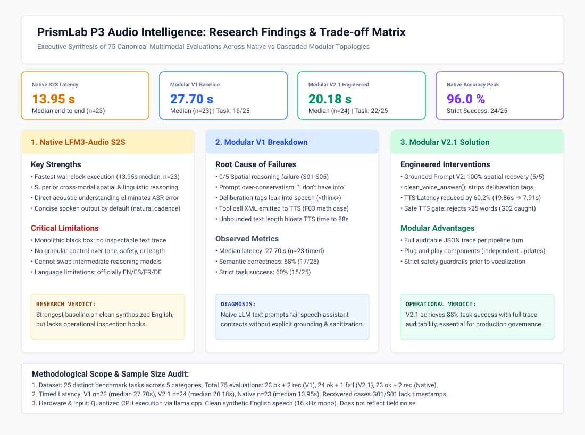
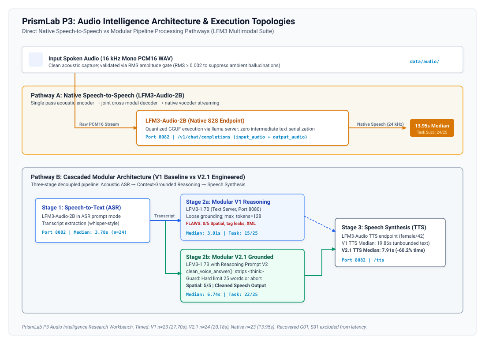
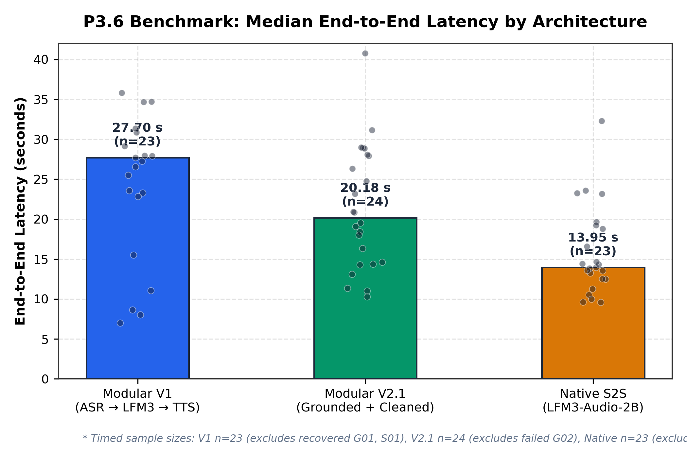
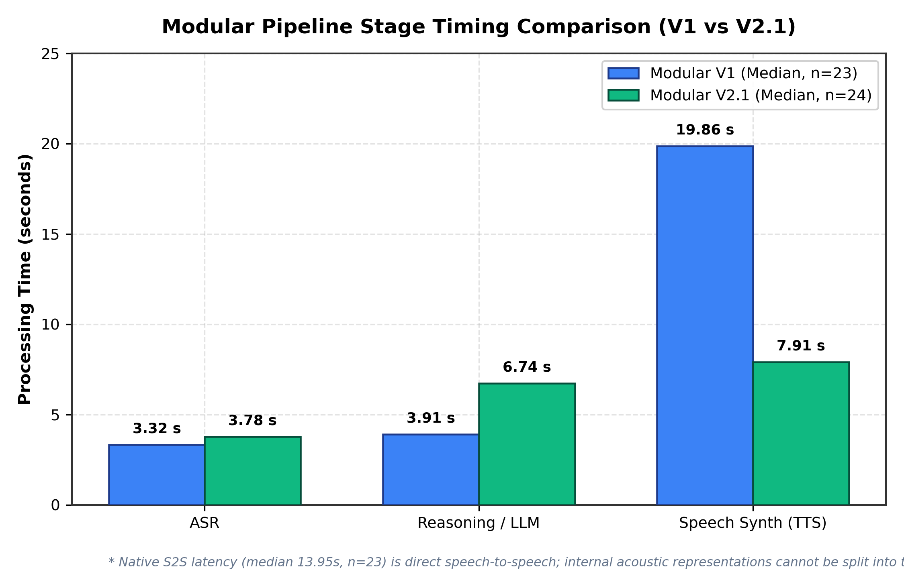
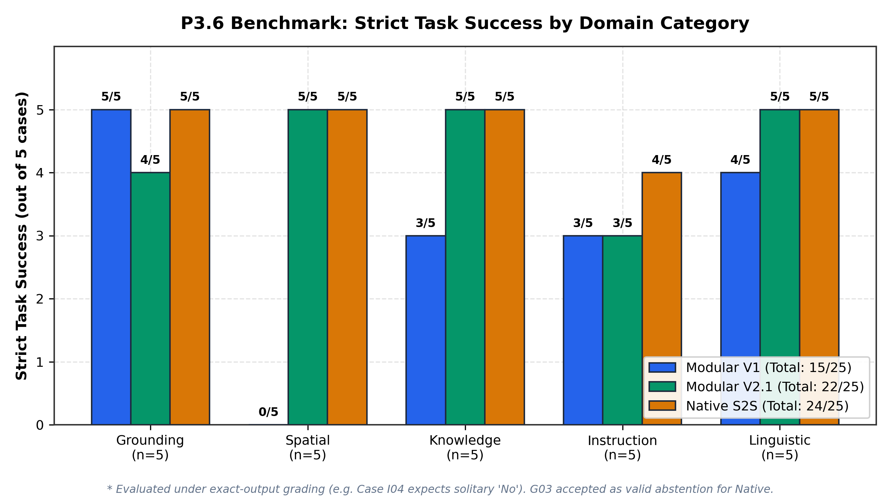
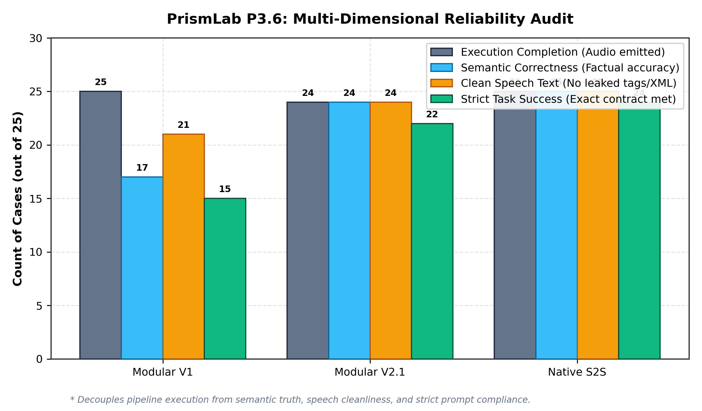
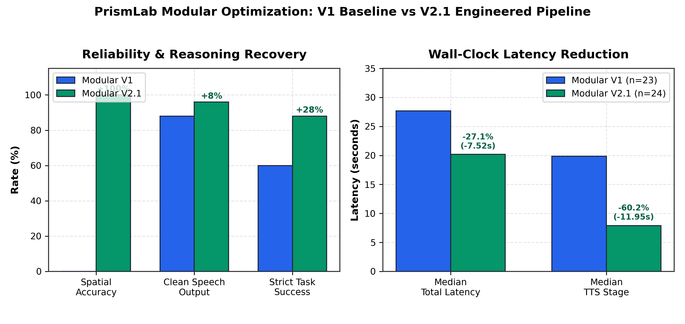

# PrismLab P3: Audio Intelligence & Multimodal Voice Architecture

**PrismLab Phase 3 Research Report**\
*Liquid Foundation Model (LFM3) Audio Intelligence & Speech Pipeline Benchmark*\
**Date:** October 2026 | **Author:** Pratay Karali | **Reviewed with:** Delta (Δ)\
**Status:** Completed & Reconciled

---

## Executive Summary

Phase 3 (P3) of **PrismLab** investigates the integration of audio and speech intelligence within an air-gapped, quantized CPU execution environment powered by `llama.cpp`. We conducted systematic empirical evaluations comparing:

1. **Direct Native Speech-to-Speech (S2S):** Single-pass multimodal model execution using `LiquidAI/LFM3-Audio-2B`.
2. **Cascaded Modular Pipelines:** Decoupled pipelines consisting of Automatic Speech Recognition (ASR), context-grounded text reasoning (`LiquidAI/LFM3-1.7B`), and speech synthesis (TTS).

Across a canonical 25-case multimodal benchmark spanning 5 domain categories (75 total evaluations across 3 architectures), **Native S2S demonstrated superior raw latency (13.95 s median, n=23) and the highest task success rate (24/25, 96.0%)** on clean synthetic English inputs. However, **Modular V2.1 proved that principled grounding prompts and generation safeguards recover spatial reasoning (from 0% in V1 to 100% in V2.1) and cut TTS latency by 60.2%**, achieving **22/25 (88.0%) strict task success and 24/24 (100%) semantic correctness on completed runs** while preserving fully auditable intermediate text traces essential for production governance.

<p align="center">
  
</p>
<p align="center">
  <em>Figure 1: Executive research synthesis, performance metrics, and architectural trade-off matrix.</em>
</p>

---

## 1. System Architectures & Execution Topologies

PrismLab evaluates two distinct architectural paradigms for audio intelligence:

<p align="center">
  
</p>
<p align="center">
  <em>Figure 2: Processing pathways for Native Speech-to-Speech versus Cascaded Modular pipelines.</em>
</p>

### 1.1 Pathway A: Native Speech-to-Speech (`LFM3-Audio-2B`)
- **Server:** Local `llama-server` on port `8082`.
- **Mechanism:** Ingests base64-encoded mono PCM16 audio (16 kHz) directly within OpenAI-compatible chat completion payloads (`input_audio`).
- **Processing:** Direct cross-modal attention maps acoustic embeddings to internal representations and decodes directly to 24 kHz speech tokens, bypassing intermediate text serialization.
- **Trade-off:** Minimal latency (13.95 s median) and natural vocal cadence, but functions as a black box without accessible intermediate reasoning traces.

### 1.2 Pathway B: Cascaded Modular Pipeline (`ASR → LFM3-1.7B → TTS`)
- **Stage 1 (ASR):** `LFM3-Audio-2B` operating in transcription mode (`"Perform ASR in English"`).
- **Stage 2 (Reasoning):** `LFM3-1.7B` on port `8080` processes the extracted transcript.
- **Stage 3 (TTS):** Spoken output synthesized via `/tts` endpoint (`LFM3-Audio-2B`, voice: female, seed: 42).
- **Evolution:**
  - **Modular V1 (Baseline):** Unconstrained text generation (`max_tokens: 128`), prone to over-conservative refusal, deliberation leakage, and oversized speech output.
  - **Modular V2 (Grounding):** Revised reasoning prompt instructing the model to rely on stated facts while maintaining explicit ignorance of unprovided personal details.
  - **Modular V2.1 (Production Safeguards):** Deterministic output sanitization (`clean_voice_answer`), stripping `<think>` tags, and enforcing a hard 25-word limit with safe TTS refusal.

---

## 2. Experimental Progression: P3.1 – P3.6

| Experiment | Focus Area | Canonical Script | Primary Artifacts & Findings |
|:---|:---|:---|:---|
| **P3.1** | Push-to-Talk Live ASR & Silence Gate | `experiments/p3/live_asr_v3.py` | RMS amplitude gate (`min_rms=0.002`) eliminates hallucinated speech from silent audio frames. |
| **P3.2** | Grounded Audio Question Answering | `experiments/p3/audio_qa.py` | 18-case QA benchmark across 3 WAV clips (`data/audio/`). Baseline prompt achieved 75% on answerable and 50% on unanswerable questions. |
| **P3.3** | Multilingual ASR Capabilities | `experiments/p3/multilingual_asr.py` | Validated European locales (EN, ES, FR, DE); documented severe token degradation on unsupported Indic locales (`bn`). |
| **P3.4** | Local Speech Synthesis (TTS) | `experiments/p3/tts_learning.py` | Quantified Real-Time Factor (RTF ≈ 3.8 on CPU); identified linear relationship between character count and synthesis latency. |
| **P3.5** | Native vs Modular Pilot | `experiments/p3/audial/live_test.py` | Direct timing comparison demonstrating a 2.1× latency advantage for native speech decoding over cascaded HTTP hops. |
| **P3.6** | 25-Case Reliability Benchmark | `benchmarks/p3/generate_analysis_table.py` | Formal 75-run evaluation across Grounding, Spatial, Knowledge, Instruction, and Linguistic categories. |

---

## 3. Reconciled Benchmark Evaluation (P3.6)

### 3.1 Reconciliation & Sample Count Audit
The canonical publishable evaluation dataset ([`p36_reconciled_graded.csv`](../../results/p3/reliability/p36_reconciled_graded.csv)), derived from local execution records, records exactly 75 evaluations across 3 architectures:
- **Modular V1:** 23 `ok`, 2 `recovered` (`G01`, `S01`), 0 `failed`. Exactly **23 timed runs** (median 27.70 s).
- **Modular V2.1:** 24 `ok`, 0 `recovered`, 1 `failed` (`G02`). Exactly **24 timed runs** (median 20.18 s).
- **Native S2S:** 23 `ok`, 2 `recovered` (`G01`, `S01`), 0 `failed`. Exactly **23 timed runs** (median 13.95 s).

*Note on Recovered Cases:* `G01` and `S01` in V1 and Native were recovered from early exploratory sessions. Their output audio and semantic responses were verified, but because they lacked wall-clock stage timestamps, they are strictly excluded from timed latency aggregates to avoid manufacturing missing measurements. Raw multi-megabyte audio outputs and intermediate traces are preserved locally and excluded from version control for repository portability.

### 3.2 Evaluation Metrics & Rubric Decoupling
To prevent conflating distinct engineering failure modes, performance is decoupled into four rigorous metrics:
1. **Execution Success:** Pipeline executed to completion and emitted valid audio without an unhandled crash.
2. **Semantic Correctness:** Factual accuracy of the response content regardless of word length, formatting preamble, or leaked deliberation tokens.
3. **Clean Speech Text:** Output text is clean, speakable text free of `<think>`, `</think>`, `<tool_call>`, or markdown code blocks.
4. **Strict Task Success (Exact-Output Rubric):** Strict adherence to all task instructions, formatting constraints (e.g. Case I04 expecting strictly solitary `No`), brevity requirements, and factual correctness.

### 3.3 Quantitative Audit Results

| Architecture | Total Cases | Completed Runs | Semantic Correctness | Clean Speech Text | Strict Task Success (Final Rubric) | Strict Task Success (Prior Rubric) | Timed Sample ($n$) | Median Latency (s) | Mean Latency (s) |
|:---|:---:|:---:|:---:|:---:|:---:|:---:|:---:|:---:|:---:|
| **Modular V1** | 25 | 25 (100%) | 17 / 25 (68.0%) | 22 / 25 (88.0%) | **15 / 25 (60.0%)** | 16 / 25 (64.0%) | **23** | 27.70 s | 30.31 s |
| **Modular V2.1** | 25 | 24 (96.0%)\* | 24 / 25 (96.0%)\*\* | 24 / 25 (96.0%) | **22 / 25 (88.0%)** | 22 / 25 (88.0%) | **24** | 20.18 s | 21.30 s |
| **Native S2S** | 25 | 25 (100%) | **25 / 25 (100%)** | **25 / 25 (100%)** | **24 / 25 (96.0%)** | 24 / 25 (96.0%) | **23** | **13.95 s** | **15.84 s** |

*\*Modular V2.1 Case G02 was an intentional execution halt by generation length safeguards.*
*\*\*Modular V2.1 semantic correctness on completed runs is 24/24 (100%).*

---

## 4. Latency & Stage Timing Analysis

<p align="center">
  
  
</p>
<p align="center">
  <em>Figure 3: (Left) End-to-end wall-clock latency by architecture with individual sample distributions (V1 n=23, V2.1 n=24, Native n=23). (Right) Modular stage breakdown comparing V1 and V2.1 processing times.</em>
</p>

### 4.1 Latency Insights
1. **Native Speed Advantage:** Native S2S achieved a median latency of **13.95 s** ($n=23$), outperforming Modular V1 (27.70 s, $n=23$) by 49.6% and Modular V2.1 (20.18 s, $n=24$) by 30.9%. Native audio token emission avoids multiple serialization round-trips.
2. **The Modular Bottleneck:** In Modular V1, speech synthesis accounted for **71.7% of total pipeline latency** (median 19.86 s out of 27.70 s). Verbose responses directly inflated audio synthesis time.
3. **The V2.1 Efficiency Gain:** By enforcing concise, single-sentence answers, V2.1 reduced median TTS time from **19.86 s down to 7.91 s (-60.2%)**, producing an overall 7.52 s wall-clock savings despite a modest increase in reasoning time (due to reasoning prompt instructions).

---

## 5. Domain Accuracy & Failure Analysis

<p align="center">
  
  
</p>
<p align="center">
  <em>Figure 4: (Left) Strict task success across the 5 evaluation categories. (Right) Multi-dimensional reliability comparison decoupling execution completion, semantic correctness, clean speech text, and strict task success.</em>
</p>

### 5.1 Category Performance Breakdown

| Category | Description | Modular V1 | Modular V2.1 | Native S2S |
|:---|:---|:---:|:---:|:---:|
| **Grounding (G01–G05)** | Hallucination resistance on unstated private facts | 5 / 5 | 4 / 5\* | **5 / 5** |
| **Spatial (S01–S05)** | Extracting relative spatial coordinates from text | 0 / 5 | **5 / 5** | **5 / 5** |
| **Knowledge (F01–F05)** | Factual QA (attention, ASR acronym, math, RAM) | 3 / 5 | **5 / 5** | **5 / 5** |
| **Instruction (I01–I05)** | Strict formatting (single word, single number, exact phrase) | 3 / 5 | 3 / 5 | **4 / 5** |
| **Linguistic (L01–L05)** | Negation, phonetic clarification, temporal order | 4 / 5 | **5 / 5** | **5 / 5** |

### 5.2 Case-by-Case Failure & Rubric Audit

<p align="center">
  
</p>
<p align="center">
  <em>Figure 5: Measured impact of Modular V2.1 prompt grounding and generation safeguards.</em>
</p>

1. **V1 Spatial Collapse (0/5):** In cases `S01`–`S05`, Modular V1 consistently answered:
   > *"I don't have enough information about their positions or relationships to determine the red cube's location..."*\
   Despite the fact that the spatial relationship was explicitly stated in the prompt (e.g., *"The red cube is under the blue box"*), V1's prompt triggered over-conservative refusal. Modular V2.1 resolved this completely (**5/5, 100%**).
2. **Instruction Case `I04` ("Answer yes or no only. Is four greater than nine?"):**
   - *Modular V1:* Emitted `"Yes or no: No, 4 is not greater than 9. (One sentence, under 25 words.)"`. This is **semantically correct** (the answer is No), but **fails strict task success** due to the preamble.
   - *Modular V2.1 & Native S2S:* Both emitted `"No, 4 is not greater than 9."`. While semantically correct, under the strict exact-output rubric expecting strictly solitary `"No"`, both fail strict task success for appending explanatory text.
3. **Linguistic Precision Tests (`L01`–`L05`):**
   - Testing acoustic and semantic disambiguation (negation, phonetic near-homophones, temporal ordering). These evaluate factual/linguistic understanding rather than solitary-token constraints.
   - Modular V2.1 correctly resolved all five cases (**5/5, 100%**), while V1 failed `L01` through an unnecessary refusal.
4. **Instruction Case `I02` ("Answer using only a number. What is seven plus five?"):**
   - *Modular V1:* Leaked an unclosed `<think>` deliberation block without finishing the answer (**both semantic and task failure**).
   - *Modular V2.1:* Emitted `"7 + 5 = 12 12"`. This is **semantically correct** (identifies 12), but **fails strict task success** for including equation tokens instead of strictly a single number.
   - *Native S2S:* Emitted `"12"` (**strict task success**).
5. **Deliberation Leakage in Speech (`F01`, `F05`):** In `F01`, Modular V1 leaked raw `</think>` deliberation tokens into the speech synthesizer:
   > `F01 Answer:` *"...projections to capture pairwise relationships within sequences. (19 words)</think>Self-attention computes..."*\
   Speaking internal thoughts aloud degrades user trust. Modular V2.1's `clean_voice_answer` regex parser completely eradicated this failure mode.
6. **Tool Call Emission (`F03`):** Modular V1 emitted raw `<tool_call>` XML when asked a basic math question (`9 * 7`), attempting to call an unconfigured `AnswerStyle` tool. V2.1 answered cleanly: *"9 times 7 is 63."*
7. **Safety Gate Activation (`G02`):** Modular V2.1 case `G02` generated 29 words answering *"What time is my meeting tomorrow?"*. The pipeline safely trapped the oversized output and refused to execute TTS, recording an audit trace without vocalizing non-compliant speech.

---

## 6. Scientific Limitations & Boundary Conditions

To maintain scientific integrity, the findings of this benchmark must be interpreted within their experimental scope:

1. **Clean Acoustic Conditions:** All 25 test audio inputs were generated using synthetic, high-fidelity English TTS (16 kHz mono). The benchmark does not reflect degraded real-world conditions such as background noise, reverberation, overlapping speakers, or heavy regional accents.
2. **Single-Run Determinism:** Evaluations were executed at `temperature: 0`. While deterministic, multi-seed variance and confidence intervals were not computed.
3. **No Automatic Semantic Equivalence:** Task success was graded through rigorous human review against explicit evaluation rubrics, distinguishing semantic correctness from superficial string matching.
4. **Aesthetic vs Functional Superiority:** Native S2S demonstrated superior speed and naturalness, but modular architectures remain essential whenever auditable logging, intermediate policy filtering, or dynamic tool orchestration is required.

---

## 7. Reproduction Instructions

### 7.1 Environment Setup
PrismLab operates offline using Python 3.10+ standard libraries and local `llama-server` instances:

```bash
# Verify environment and dependencies
cd lfm3-prismlab
pip install -e .
```

### 7.2 Running Local Inference Servers
Launch the quantized models using `llama.cpp`:

```bash
# Terminal 1: Text Reasoning Server (Port 8080)
llama-server -hf LiquidAI/LFM3-1.7B-GGUF:Q4_K_M \
  --alias lfm3-text --host 127.0.0.1 --port 8080 -c 2048 -ngl 0

# Terminal 2: Audio & Speech Server (Port 8082)
llama-server -hf LiquidAI/LFM3-Audio-2B-GGUF:Q4_0 \
  --alias lfm3-audio --host 127.0.0.1 --port 8082 -c 2048 -ngl 0
```

### 7.3 Executing the Pipelines
```bash
# Run Modular V2.1 on an audio file
python experiments/p3/modular_v21.py --wav results/p3/reliability/inputs/F01_16k.wav --case-id F01

# Run offline unit test suite
python tests/test_modular_v21.py
```

### 7.4 Reproducing Benchmark Figures
```bash
# Recompute canonical analysis table
python benchmarks/p3/generate_analysis_table.py

# Replot all 5 publication figures
python benchmarks/p3/plot_all_figures.py

# Generate contact sheet and SVG previews
python benchmarks/p3/generate_contact_sheet.py
```

---

## 8. Lessons for PrismLab Core Integration

1. **Deterministic Router Update:** `prismlab/core/router.py` correctly maps `{"audio"}` and `{"speech"}` tasks to the audio engine. The pipeline engine should support both direct native streaming and auditable modular dispatch via an execution flag.
2. **Generation Safeguards are Mandatory:** Decoupled LLM reasoning nodes must enforce strict length and thinking-token sanitizers prior to downstream speech synthesis.
3. **Selective Architecture Dispatch:** Real-time conversational queries benefit most from Native S2S, whereas queries requiring tool retrieval, policy evaluation, or formal transcript logging should route to Modular V2.1.
