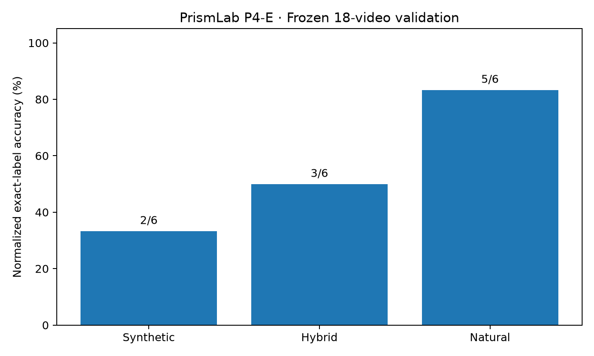
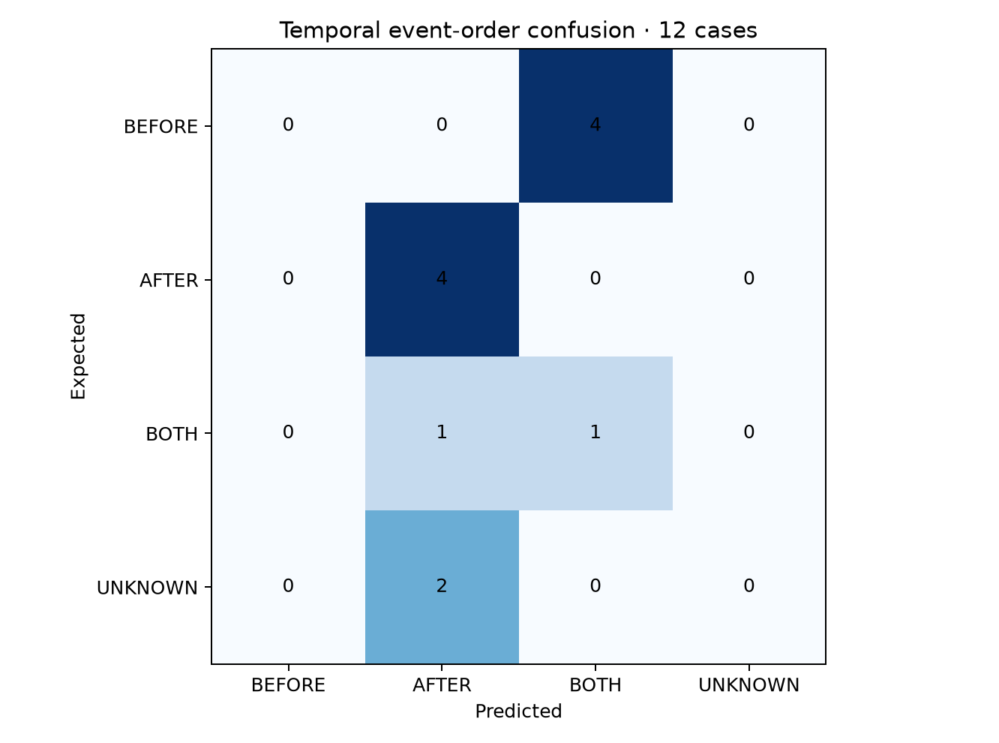
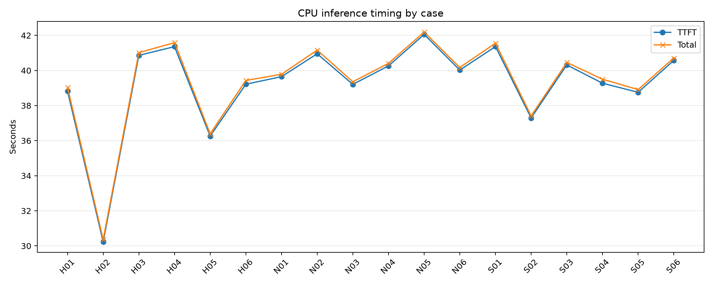

# PrismLab P4-E · Frozen 18-video evaluation

## Experiment and integrity

- Model API label: `lfm3-omni`; local CPU inference; model binary and exact server flags were not embedded in this results JSON.
- Frozen manifest SHA256: `fef2493909a5d55a4e358387f2f470ecb43bb73f925c3b7c5b51a8df76e69b8a`
- Cases/trials: 18/18; errors: 0.
- Fixed seed: 404 in the provided evaluation script; each case evaluated once (no repetitions).
- Scoring: one correct label, permitting terminal punctuation, according to the frozen evaluation runner.
- Six synthetic, six hybrid (original soundtrack replaced), and six natural (original soundtrack retained) cases.

## Results

- Overall normalized correct: **10/18 (55.6%)**.
- Strict exact-token correct: **10/18 (55.6%)**.
- Median TTFT: **39.835 s**; median total: **39.978 s**.

| Category | Correct | Accuracy | Median TTFT (s) | Median total (s) |
|---|---:|---:|---:|---:|
| synthetic | 2/6 | 33.3% | 39.796 | 39.981 |
| hybrid | 3/6 | 50.0% | 39.021 | 39.236 |
| natural | 5/6 | 83.3% | 40.142 | 40.290 |

### Temporal-order labels (synthetic + hybrid only)

| Expected | Correct | Predictions |
|---|---:|---|
| BEFORE | 0/4 | BOTH: 4 |
| AFTER | 4/4 | AFTER: 4 |
| BOTH | 1/2 | AFTER: 1, BOTH: 1 |
| UNKNOWN | 0/2 | AFTER: 2 |

### Complete case-level record

| Case | Type | Expected | Actual | Correct | TTFT (s) | Total (s) | Error |
|---|---|---|---|---|---:|---:|---|
| H01 | hybrid | BEFORE | BOTH | False | 38.824 | 39.042 | - |
| H02 | hybrid | AFTER | AFTER | True | 30.232 | 30.369 | - |
| H03 | hybrid | UNKNOWN | AFTER | False | 40.862 | 41.016 | - |
| H04 | hybrid | BEFORE | BOTH | False | 41.359 | 41.588 | - |
| H05 | hybrid | AFTER | AFTER | True | 36.257 | 36.391 | - |
| H06 | hybrid | BOTH | BOTH | True | 39.218 | 39.431 | - |
| N01 | natural | BELL | BELL | True | 39.646 | 39.784 | - |
| N02 | natural | GUITAR | GUITAR | True | 40.952 | 41.162 | - |
| N03 | natural | CLOCK | CLOCK | True | 39.208 | 39.356 | - |
| N04 | natural | APPLAUSE | BELL | False | 40.262 | 40.408 | - |
| N05 | natural | CLOCK | CLOCK | True | 42.056 | 42.190 | - |
| N06 | natural | WATER | WATER | True | 40.023 | 40.172 | - |
| S01 | synthetic | BEFORE | BOTH | False | 41.363 | 41.555 | - |
| S02 | synthetic | AFTER | AFTER | True | 37.292 | 37.411 | - |
| S03 | synthetic | UNKNOWN | AFTER | False | 40.317 | 40.459 | - |
| S04 | synthetic | BEFORE | BOTH | False | 39.275 | 39.502 | - |
| S05 | synthetic | AFTER | AFTER | True | 38.755 | 38.909 | - |
| S06 | synthetic | BOTH | AFTER | False | 40.573 | 40.713 | - |

## Figures

## Interpretation and limitations

- Natural sound-source identification and temporal event-ordering are different tasks with different label sets and difficulty; do not attribute category differences solely to modality.
- Controlled temporal cases share an event template and are not independent random samples; no generalization or statistical significance claims follow from the descriptive percentages.
- Zero errors means the requests completed; it does not imply model correctness or robust runtime behavior on other inputs.
- One inference per case, one prompt formulation and a small natural-video subset. No systematic audio-only/video-only ablations were performed for this frozen set.
- Visible objects might cue natural source labels without audible recognition; this evaluation alone cannot establish cross-modal fusion.
- Timing comes from the client streaming API; no per-trial peak RAM, peak VRAM or power measurements are present.
- The older P4-E pilot, P4-E+ counterfactual test and P4-D image/audio evaluations are separate experiments, not pooled into these 18 trials.
- Source licenses and attribution must be handled separately from this automatically generated analysis. Do not commit third-party video files by default.
