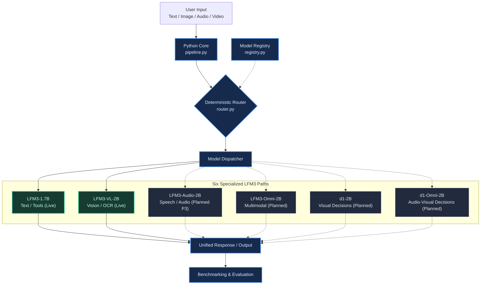

# PrismLab — Architecture Visualizations & Animations

This directory contains architectural diagrams, interactive explainers, and Manim animation source assets for the PrismLab multimodal research workbench.

---

## 1. Directory Structure

```text
visuals/
├── README.md                               # Visuals catalog, regeneration guide, and tooling
├── PrismLabs_Architecture_Extended.ipynb   # Interactive architecture flow notebook
├── PrismLabs_Architecture_Extended.html    # Standalone interactive SVG/HTML architecture viewer
├── PrismLabs_Architecture_Extended.png     # Rendered high-resolution architecture graphic
├── PrismLabs_Architecture_Extended.svg     # Standalone SVG architecture graphic
├── mermaid/                                # Editable Mermaid architecture definitions
│   ├── prismlab_p1_overview.mmd            # Complete 6-model deterministic routing topology
│   └── prismlab_p1_glow.mmd                # Active runtime pathways highlight diagram
└── manim/                                  # Mathematical & procedural animation assets
    ├── PrismLab_MultiModel_Architecture.ipynb # Jupyter notebook generating Manim animation
    ├── PrismLab_MultiModel_Architecture.html  # Standalone interactive architecture viewer
    ├── PrismLab_P1_Live_Glow_Architecture.html # Glow explainer variant with active paths
    ├── PrismLabs_Architecture_Extended.html   # Extended architecture visualization
    ├── prismlab_p1_glow.html               # Lightweight CSS-illuminated flow diagram
    └── PrismLabP1Architecture.mp4          # Final rendered 720p30 demonstration video
```

---

## 2. Visual Catalog & Phase Mapping

| Asset Name | Format | Primary Phase | Description |
| :--- | :--- | :--- | :--- |
| [`PrismLabs_Architecture_Extended.png`](PrismLabs_Architecture_Extended.png) | PNG (1600x1100) | **Core / All** | High-resolution visual representation of the multi-model architecture. |
| [`PrismLabs_Architecture_Extended.html`](PrismLabs_Architecture_Extended.html) | Interactive HTML | **Core / All** | Full interactive SVG visualization with click-to-highlight workflows. |
| [`PrismLabs_Architecture_Extended.ipynb`](PrismLabs_Architecture_Extended.ipynb) | Jupyter Notebook | **Core / All** | Source notebook generating and embedding the extended architecture. |
| [`prismlab_p1_overview.mmd`](mermaid/prismlab_p1_overview.mmd) | Mermaid | **P1 / Core** | Full multi-model deterministic routing topology mapping modalities to the 6 Liquid AI models. |
| [`prismlab_p1_glow.mmd`](mermaid/prismlab_p1_glow.mmd) | Mermaid | **P1 & P2** | Highlighted architecture showing live deployed pathways (`LFM3-1.7B` text and `LFM3-VL-2B` vision) vs. planned pathways (`audio`, `omni`, `d1`). |
| [`PrismLabP1Architecture.mp4`](manim/PrismLabP1Architecture.mp4) | MP4 (720p30) | **P1** | 30fps procedural Manim animation illustrating request intake, deterministic dispatch, and local token generation. |
| [`PrismLab_MultiModel_Architecture.html`](manim/PrismLab_MultiModel_Architecture.html) | HTML | **P1 & P2** | Self-contained interactive web visualization with node inspection and theme toggling. |
| [`PrismLab_P1_Live_Glow_Architecture.html`](manim/PrismLab_P1_Live_Glow_Architecture.html) | HTML | **P1** | Interactive glow visualization illustrating active model paths during inference. |

---

## 3. Mermaid Architecture Source

Below is the editable Mermaid representation of the deterministic router architecture (`visuals/mermaid/prismlab_p1_overview.mmd`):



---

## 4. Regeneration Instructions

### 4.1 Rendering Manim Animations

Manim is installed in the project environment (`.venv`). To regenerate the release MP4 or preview scenes:

```bash
# Activate workspace environment
source ../.venv/bin/activate

# Execute notebook to regenerate HTML / Manim assets
jupyter execute visuals/manim/PrismLab_MultiModel_Architecture.ipynb
```

*(Note: Temporary render chunks and SVG text rasters are excluded by `.gitignore` to maintain a lightweight repository index. Only the finalized `.mp4` is committed).*

### 4.2 Exporting Mermaid Diagrams

Mermaid diagrams can be edited directly in Markdown or converted to SVG/PNG using `@mermaid-js/mermaid-cli`:

```bash
mmdc -i visuals/mermaid/prismlab_p1_overview.mmd -o docs/p1/figures/prismlab_p1_overview.svg -t dark
```
